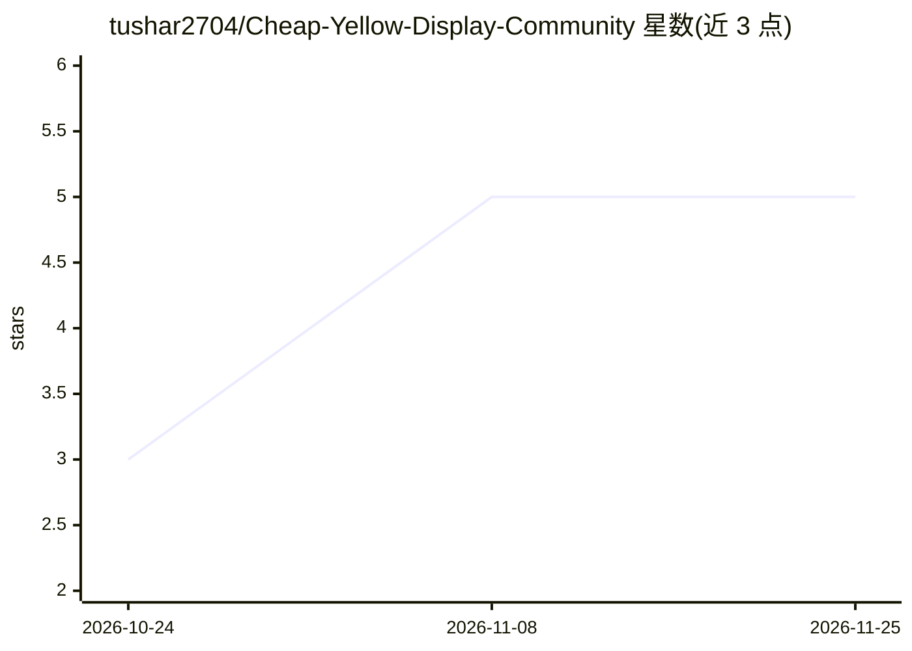

# tushar2704/Cheap-Yellow-Display-Community

⭐ 5 · C++ · NOASSERTION · 推送 2026-11-07 · [GitHub](https://github.com/tushar2704/Cheap-Yellow-Display-Community) · [官网](https://tushar2704.github.io/Cheap-Yellow-Display-Community/) · 组织维护

**ESP32 便宜黄屏（CYD）开发者社区资源中心**

面向 ESP32 Cheap Yellow Display 系列开发板的社区资源仓库：收录 9 种板型规格表、引脚映射文档、统一引脚头文件、CYD_Easy 入门库、LVGL/ESPHome/MicroPython 配置，以及按难度分级的 21 个固件项目（天气站、家居面板、BLE 雷达等）。提供浏览器内一键 Web Flasher，无需安装 Arduino IDE 或 PlatformIO 即可烧录；另附 3D 打印外壳资源与视频教程频道。代码采用 AGPL v3，外壳与素材采用 CC BY-NC-ND 4.0；赞助者可解锁私有固件与 CAD 文件。

## 筛选速览

| 维度 | 判定 | 备注 |
|---|---|---|
| AI 角色 | `ai-enhanced` | 去掉 AI 部分产品仍成立 |
| 许可风险 | `none` | NOASSERTION |
| 部署形态 | `None` |  |
| 模型依赖 | — | README 未给出锁定关系 |
| 硬件要求 | — | 无带数字的原话,不猜 |
| 安装摩擦 | `low` | 无编译、无系统依赖或容器化 |
| 成熟度 | — | 结构信号不足 |

## 能力要点

- 浏览器 1-Click Web Flasher，Chrome/Edge/Opera 经 Web Serial 直接烧录固件
- 覆盖 7+ 种 CYD 屏幕尺寸（2.4"–7.0"）与电阻/电容触控型号
- 统一引脚抽象 cyd_pins.h 与 CYD_Easy 三行入门库
- 按难度分级的社区项目集：入门/仪表盘/高级固件三类

## 适用场景

- 我买了块 ESP32-2432S028R，想不用装 IDE 就把固件烧进去
- 我想找特定 CYD 板型的引脚定义和触控驱动
- 我想给 CYD 做智能家居墙面控制面板
- 我需要 3D 打印外壳文件来装我的 CYD

## 场景标签

`教程课程` · 领域:学习与行业

## 证据(README 行号)

> L11: > **The ultimate open-source community hub for ESP32 Cheap Yellow Display (CYD) — covering every size, every varian
> L74: - 📦 **Unified `CYD_Easy` Library**: A 3-line beginners' library in `library/CYD_Easy/` providing instant hardware i
> L82: - 🛡️ **Dual AGPLv3 + Creative Commons Licensing**: Strong open-source copyleft protection for code combined with co

## 星数曲线

2026-10-24 3 → 2026-11-25 5（+2）

---
*卡片 v1 · prompt 1.4 · 生成 2026-11-21 · 置信度 mid · 依据 README sha `9d1177e890c1` · [字段定义](../../DATASET.md)*
