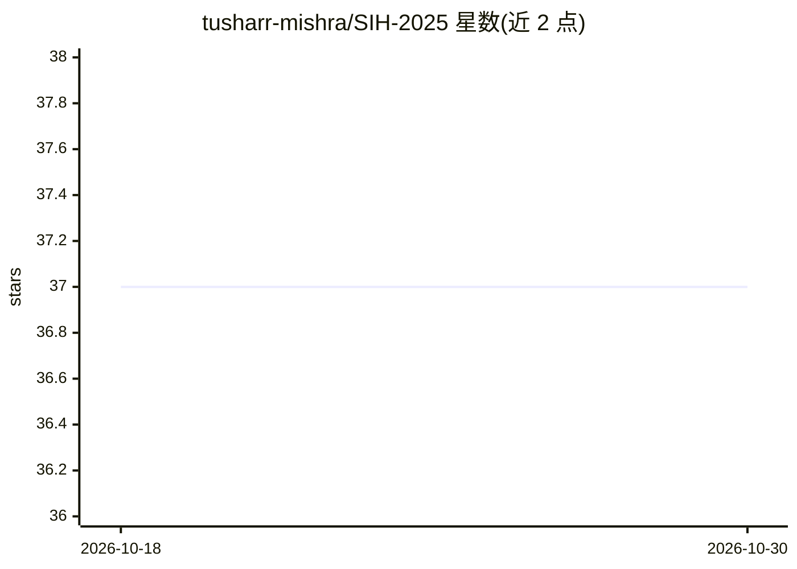

# tusharr-mishra/SIH-2025

⭐ 37 · 推送 2026-04-29 · [GitHub](https://github.com/tusharr-mishra/SIH-2025) · 个人维护

**Smart India Hackathon 2025 参赛方案集：离线多模态 RAG 与游客安全平台设计**

个人参加 Smart India Hackathon 2025 的项目集仓库，包含两个问题陈述的方案设计：一是 Vault RAG，离线多模态 RAG 系统，采用文本/图像/音频统一嵌入、Whisper 离线语音转文字、FAISS 向量相似检索与带引用的对话式检索；二是 AtithiBandhu，基于区块链数字身份、AI 地理围栏与异常检测的游客安全平台。仓库内容为构思、方案结构与两份演示文稿 PDF，README 明确声明仅聚焦创意开发与方案设计，未提供可运行的代码或安装命令。

## 筛选速览

| 维度 | 判定 | 备注 |
|---|---|---|
| AI 角色 | `ai-knowledge` | 知识聚合/清单类 |
| 许可风险 | `none` | — |
| 部署形态 | `None` |  |
| 模型依赖 | — | README 未给出锁定关系 |
| 硬件要求 | — | 无带数字的原话,不猜 |
| 安装摩擦 | `low` | 无编译、无系统依赖或容器化 |
| 成熟度 | — | 结构信号不足 |

## 能力要点

- Vault RAG：文本/图像/音频统一嵌入的离线多模态检索方案
- Whisper 离线语音转文字 + FAISS 向量检索 + 带引用回答
- AtithiBandhu：区块链数字身份 + AI 地理围栏 + SOS 应急方案
- 包含两份问题陈述的演示文稿 PDF

## 适用场景

- 查阅离线多模态 RAG 系统的架构与技术选型思路
- 参考区块链+AI 游客安全平台的方案设计
- 了解 Smart India Hackathon 问题陈述的参赛方案结构

## 场景标签

`RAG` `多模态` · 领域:知识与检索

## 证据(README 行号)

> L14: ## Multimodal Offline RAG System
> L56: ## Smart Tourist Safety System
> L109: This repository focuses on idea development and solution design as part of hackathon participation.

## 星数曲线

2026-10-18 37 → 2026-10-30 37（+0）

---
*卡片 v1 · prompt 1.4 · 生成 2026-10-25 · 置信度 mid · 依据 README sha `6ea530e5ede5` · [字段定义](../../DATASET.md)*
