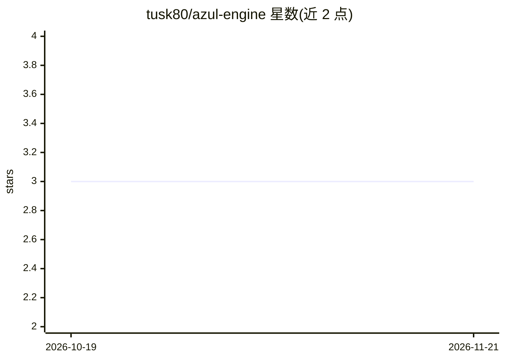

# tusk80/azul-engine

⭐ 3 · Go · MIT · 推送 2026-11-16 · [GitHub](https://github.com/tusk80/azul-engine) · [官网](https://azul.yesil.cc) · 个人维护

**Azul 双人棋盘游戏 AI 引擎，含自训练神经网络评估器**

用 Go 编写的两人 Azul 游戏 AI：规则引擎、带置换表的 alpha-beta（PVS）搜索、Lazy SMP 多线程，以及手写评估与 170→64→16→1 神经网络两种评估器。网络由引擎自对弈生成的 150 万局面监督训练（Go 无依赖实现，PyTorch/CUDA 作基准对照），推理采用 NNUE 式增量首层整数运算。同一代码库以 CLI、HTTP API 和 WebAssembly 浏览器页面交付，附带分析棋盘、每日谜题与复盘评分。README 提醒对不知情对手使用引擎属作弊。

## 筛选速览

| 维度 | 判定 | 备注 |
|---|---|---|
| AI 角色 | `ai-native` | 本体是模型或模型工具 |
| 许可风险 | `permissive` | MIT |
| 部署形态 | `desktop` | 安装包/桌面程序 |
| 模型依赖 | — | README 未给出锁定关系 |
| 硬件要求 | — | 无带数字的原话,不猜 |
| 安装摩擦 | `medium` | 含编译或系统依赖之一 |
| 成熟度 | — | 结构信号不足 |

## 能力要点

- 自对弈生成 1.5M 局面训练的 NNUE 式增量评估网络
- alpha-beta（PVS）搜索、置换表、精确残局求解与 SPSA 调参
- 单二进制同时提供 CLI、HTTP API 与 WebAssembly 浏览器运行
- 强度结论均以数千盘配对对局加置信区间测量

## 适用场景

- 在浏览器分析 Azul 局面并获得前三推荐着法
- 与引擎对弈或复盘每步着法评分
- 自己生成数据并训练/评测新的评估网络

## 场景标签

 · 领域:游戏/棋盘游戏 AI

## 证据(README 行号)

> L6: **A game AI for 2-player Azul, and a neural network that learned to beat it.**
> L36: - **Shipping:** one Go codebase as a CLI, an HTTP API and WebAssembly in the
> L50:  - *Neural*: a 170 → 64 → 16 → 1 network that predicts the final score margin.

## 星数曲线

2026-10-19 3 → 2026-11-21 3（+0）

---
*卡片 v1 · prompt 1.4 · 生成 2026-11-21 · 置信度 mid · 依据 README sha `b9c1a0d9a798` · [字段定义](../../DATASET.md)*
