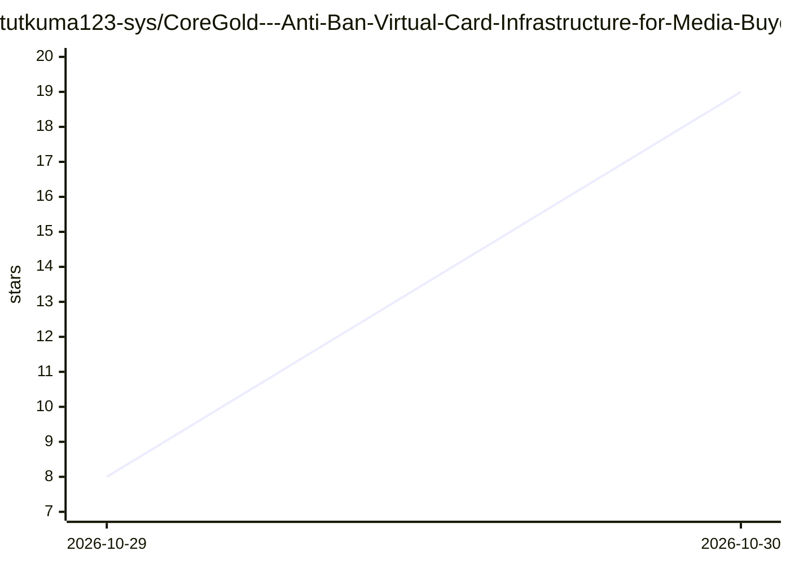

# tutkuma123-sys/CoreGold---Anti-Ban-Virtual-Card-Infrastructure-for-Media-Buyers-Cross-Border-Ops

⭐ 19 · 推送 2026-10-28 · [GitHub](https://github.com/tutkuma123-sys/CoreGold---Anti-Ban-Virtual-Card-Infrastructure-for-Media-Buyers-Cross-Border-Ops) · [官网](https://app.coregold.io/signup?invite_code=ADvlj9b) · 组织维护 · 中文 README

**面向广告投放与跨境电商的海外虚拟信用卡发卡平台（商业推广页）**

这是 CoreGold 虚拟信用卡服务的推广型 README，非开源软件：宣传独立 Visa/Mastercard 商用卡段、单商户绑定拦截、即时销卡、USDT 充值自动转美金等功能，目标用户为 Meta/TikTok 多账户买量团队与跨境电商卖家。全文为注册引导与营销话术，无代码、无安装运行方式，末尾附注册链接与疑似推广码。OpenAI/Claude 等仅作为付费订阅场景被列举，与 AI 无实质功能关联。

## 筛选速览

| 维度 | 判定 | 备注 |
|---|---|---|
| AI 角色 | `ai-enhanced` | 去掉 AI 部分产品仍成立 |
| 许可风险 | `none` | — |
| 部署形态 | `None` |  |
| 模型依赖 | — | README 未给出锁定关系 |
| 硬件要求 | — | 无带数字的原话,不猜 |
| 安装摩擦 | `low` | 无编译、无系统依赖或容器化 |
| 成熟度 | — | 结构信号不足 |

## 能力要点

- 提供 Visa/Mastercard 虚拟卡的自助开卡控制台
- 支持单商户绑定拦截与一键销卡、额度回退
- USDT 链上充值自动转换为美金资产

## 适用场景

- 广告投放团队为多账户配置独立付款卡片
- 跨境电商店铺做一店一卡的资金隔离
- 用一次性卡支付规避订阅服务静默续费

## 场景标签

 · 领域:跨境支付/广告投放基础设施

## 证据(README 行号)

> L2: 专为高频投放与跨境电商设计的防封级 Visa / Mastercard 虚拟信用卡资产平台。直连一手中继清算网络，主打 0 预付门槛、单卡即时销毁、多卡段交叉轮换与账单 0 溢扣，专治 FB/TikTok 拒付封号与店铺资金风控。
> L33: |**开发者 AI 工具栈**|`OpenAI API 绑卡`, `Claude Code / Cursor`, `Midjourney`|避开个人双币信用卡发卡行拦截，稳定扣除每月 API 与订阅账单|

## 星数曲线

2026-10-29 8 → 2026-10-30 19（+11）

---
*卡片 v1 · prompt 1.4 · 生成 2026-10-30 · 置信度 low · 依据 README sha `dd899ee344f6` · [字段定义](../../DATASET.md)*
