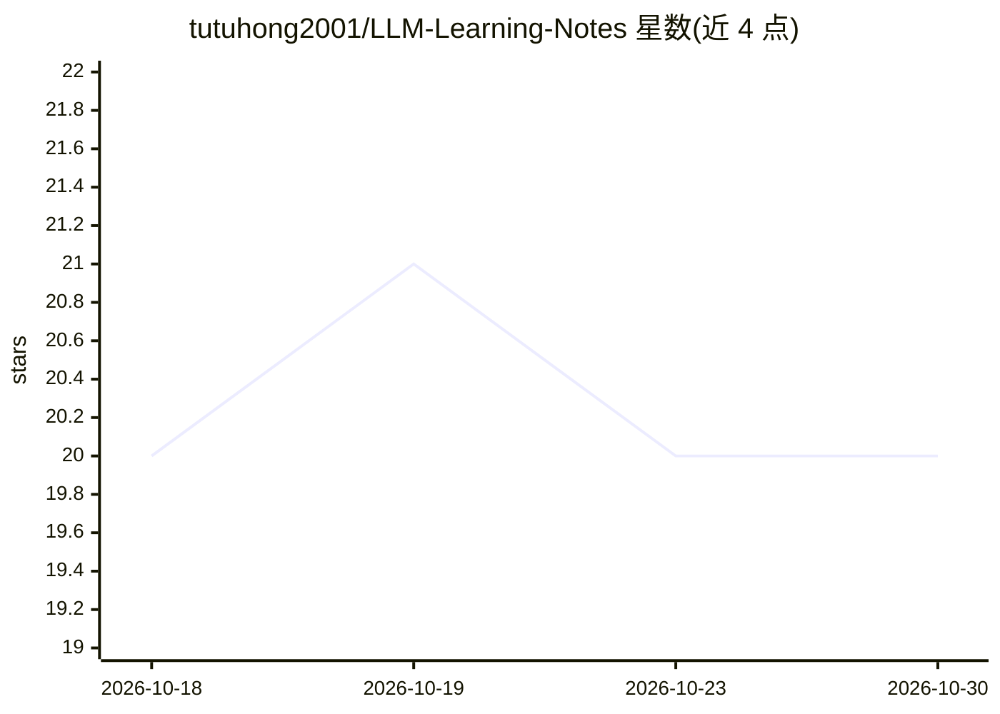

# tutuhong2001/LLM-Learning-Notes

⭐ 20 · Python · MIT · 推送 2026-10-02 · [GitHub](https://github.com/tutuhong2001/LLM-Learning-Notes) · 个人维护 · 中文 README

**中文 AI 学习笔记的最小 RAG Demo：检索评估加演示**

把 10 篇中文 AI 学习笔记构建成小型问答知识库：BM25 词法基线无需模型下载即可离线检索与评估；另支持 Sentence-Transformers（默认 BAAI/bge-small-zh-v1.5，CPU 运行）语义检索，top-k 检索后组装上下文，经 OpenAI 兼容接口生成带来源编号的回答。提供 28 题检索评估（Hit Rate/Recall/MRR）、CLI、pytest 测试与 GitHub Actions 配置。README 明示限制：知识库为人工短文档，无训练/微调、Agent 循环与线上部署，评估指标衡量检索质量而非回答准确率。适合快速演示与面试讲解。

## 筛选速览

| 维度 | 判定 | 备注 |
|---|---|---|
| AI 角色 | `ai-native` | 本体是模型或模型工具 |
| 许可风险 | `permissive` | MIT |
| 部署形态 | `desktop` | 安装包/桌面程序 |
| 模型依赖 | — | README 未给出锁定关系 |
| 硬件要求 | `cpu-ok` | |
| 安装摩擦 | `low` | 无编译、无系统依赖或容器化 |
| 成熟度 | — | 结构信号不足 |

## 能力要点

- BM25 离线路径无需 GPU、API Key 或第三方包即可检索与评估
- Sentence-Transformers（BGE 中文句向量）语义检索后端，CPU 运行
- top-k 检索 → 上下文组装 → OpenAI 兼容 API 生成 → 来源编号检查
- 检索评估（Hit Rate/Recall/MRR，含口语改写题集）与 pytest 自动化测试

## 适用场景

- 快速演示中文笔记问答的检索增强生成流程
- 对比 BM25 与语义检索在同一题集上的指标
- 面试或技术分享中讲解 RAG 设计与检索评估方法

## 场景标签

`RAG` · 领域:知识与检索

## 证据(README 行号)

> L7: 把 10 篇 AI 学习笔记变成一个小型问答知识库：先找资料，再使用 OpenAI 兼容服务生成带来源的回答。项目保留无需模型下载的 BM25 基线，也支持 Sentence-Transformers 中文语义检索，适合快速演示和面
> L16: |最小 RAG|top-k 检索 → 上下文组装 → API 生成 → 来源编号检查|
> L31: 需要 Python 3.10+。在**仓库根目录**运行，不需要 GPU、API Key 或第三方 Python 包：

## 星数曲线

2026-10-18 20 → 2026-10-30 20（+0）

---
*卡片 v1 · prompt 1.4 · 生成 2026-10-28 · 置信度 high · 依据 README sha `223155afe079` · [字段定义](../../DATASET.md)*
