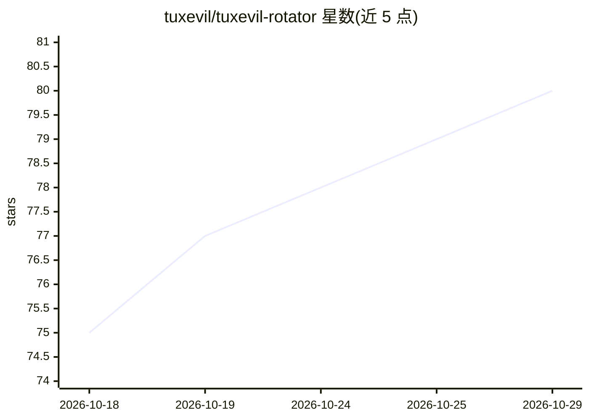

# tuxevil/tuxevil-rotator

⭐ 80 · TypeScript · MIT · 推送 2026-10-26 · [GitHub](https://github.com/tuxevil/tuxevil-rotator) · 组织维护

**多提供商多账号的 LLM 代理轮换网关，带配额路由**

OpenAI 兼容的本地 API 网关：聚合 Google Antigravity、Ollama Cloud、OpenAI Codex、OpenCode Zen 等免费层 LLM 提供商，实现多账号负载均衡、按模型配额路由、账号健康评分、Virtual Keys 访问控制与成本审计，并通过 /dashboard 提供 WebUI 管理。面向开发者和 AI agent 用户，提供 agent 自动安装提示文件。README 多处警告多账号轮换可能触发服务商封号，属非官方工具。

## 筛选速览

| 维度 | 判定 | 备注 |
|---|---|---|
| AI 角色 | `ai-ecosystem` | LLM/agent 周边工具 |
| 许可风险 | `permissive` | MIT |
| 部署形态 | `self-host` | docker 或自建部署 |
| 模型依赖 | local-ok | 支持本地模型 |
| 硬件要求 | — | 无带数字的原话,不猜 |
| 安装摩擦 | `low` | 无编译、无系统依赖或容器化 |
| 成熟度 | — | 结构信号不足 |

## 能力要点

- 多账号负载均衡与按模型配额路由
- OpenAI/Anthropic/Gemini 兼容路由层
- 账号健康评分与 Virtual Keys 访问控制
- Preact WebUI 仪表盘：路由健康、请求历史、用量分析

## 适用场景

- 把多个免费层 LLM 账号聚合为一个本地端点供 agent 使用
- 在账号间自动轮换以规避单账号配额上限
- 对代理流量做成本审计与用量分析

## 场景标签

`模型网关` · 领域:Agent 开发

## 证据(README 行号)

> L21: **Production-ready OpenAI-compatible gateway for multiple free-tier LLM providers.**
> L27: Multi-account load balancing, per-model quota routing, account health scoring, access control with Virtual Keys, an
> L29: Originally built as a multi-account rotator for Google Antigravity. It now generalizes that rotation layer across f

## 星数曲线

2026-10-18 75 → 2026-10-29 80（+5）

---
*卡片 v1 · prompt 1.4 · 生成 2026-10-24 · 置信度 high · 依据 README sha `ccf9ba5239e5` · [字段定义](../../DATASET.md)*
