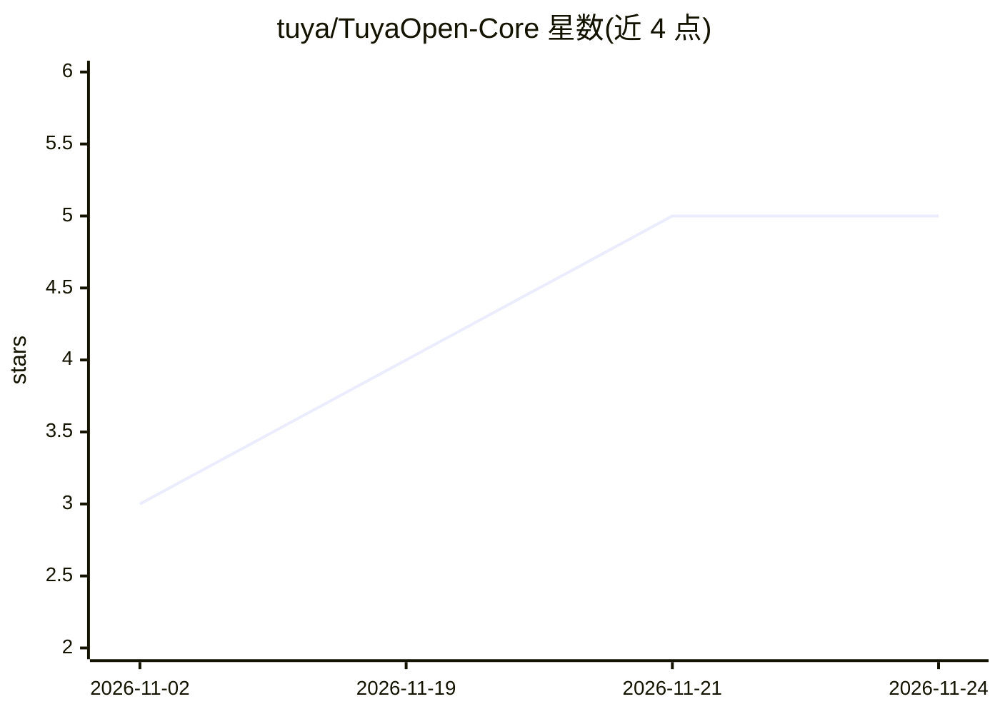

# tuya/TuyaOpen-Core

⭐ 5 · C · 推送 2026-11-23 · [GitHub](https://github.com/tuya/TuyaOpen-Core) · [官网](https://tuyaopen.ai) · 组织维护 · 中文 README

**给嵌入式设备项目接入涂鸦云 IoT/AI/P2P 能力的 C SDK**

面向已有设备项目的 C SDK 库：通过薄平台适配层保留项目原有 OS 与厂商 SDK，接入涂鸦云的 IoT 能力（激活、认证、数据点、云控制、OTA）、AI Agent（云端语音/文本对话、可选 MCP）与 P2P 音视频。提供 Linux/POSIX、ESP-IDF、TuyaOpen 三种平台适配，CMake/Kconfig 构建入口与 Linux 示例工程，并附 ESP32-S3 的 Flash/RAM 资源占用实测数据。完整 TuyaOpen 框架则面向新产品的整套构建环境。

## 筛选速览

| 维度 | 判定 | 备注 |
|---|---|---|
| AI 角色 | `ai-ecosystem` | LLM/agent 周边工具 |
| 许可风险 | `none` | — |
| 部署形态 | `None` |  |
| 模型依赖 | — | README 未给出锁定关系 |
| 硬件要求 | — | 无带数字的原话,不猜 |
| 安装摩擦 | `medium` | 含编译或系统依赖之一 |
| 成熟度 | `idea` | |

## 能力要点

- 薄适配层设计，保留已有 OS 与厂商 SDK
- AI Agent 提供云端语音/文本对话，可选 MCP 能力
- 支持 Linux/POSIX、ESP-IDF、TuyaOpen 平台适配
- 附 ESP32-S3 资源占用实测数据

## 适用场景

- 让已有设备固件接入涂鸦云的激活、控制与 OTA
- 给设备加云端语音/文本 AI 对话能力
- 为设备实现 P2P 音视频通信

## 场景标签

`语音 Agent` `AI 助手` · 领域:对话与助手

## 证据(README 行号)

> L5: TuyaOpen Core is a C SDK library for adding Tuya Cloud capabilities to an existing device project while keeping its 
> L12: |AI Agent|Cloud voice and text conversations, with optional MCP capabilities.|
> L17: The application uses the capabilities it needs. Tuya Cloud connectivity and platform services are provided through 

## 星数曲线

2026-11-02 3 → 2026-11-24 5（+2）

---
*卡片 v1 · prompt 1.4 · 生成 2026-11-21 · 置信度 high · 依据 README sha `f64a10c2e4df` · [字段定义](../../DATASET.md)*
