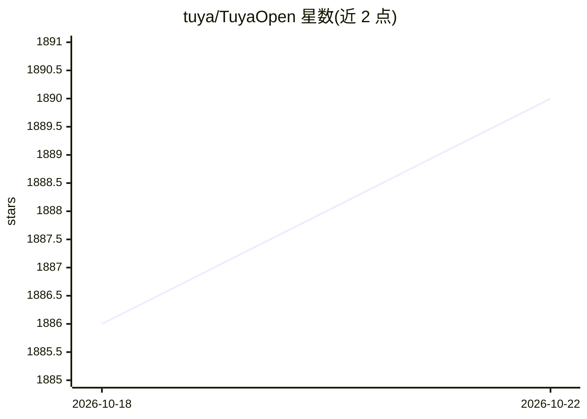

# tuya/TuyaOpen

⭐ 1,892 · C · NOASSERTION · 推送 2026-10-22 · [GitHub](https://github.com/tuya/TuyaOpen) · [官网](https://tuyaopen.ai) · 组织维护 · 中文 README

**面向 IoT 硬件开发者的 AI+IoT 嵌入式 C/C++ SDK**

涂鸦开源的跨平台 C/C++ 嵌入式开发框架，支持 Tuya T2/T3/T5 系列、ESP32、Ubuntu 等平台。开发者可用其构建带 ASR/KWS/TTS/STT 语音能力的硬件产品，接入 Deepseek、ChatGPT、Claude、Gemini 等 LLM，并连接涂鸦云实现远程控制、监控与 OTA 升级。框架内置设备认证与数据加密，支持 Google Home 与 Amazon Alexa 兼容设备开发。采用 Apache 2.0 许可。

## 筛选速览

| 维度 | 判定 | 备注 |
|---|---|---|
| AI 角色 | `ai-ecosystem` | LLM/agent 周边工具 |
| 许可风险 | `none` | NOASSERTION |
| 部署形态 | `None` |  |
| 模型依赖 | — | README 未给出锁定关系 |
| 硬件要求 | — | 无带数字的原话,不猜 |
| 安装摩擦 | `low` | 无编译、无系统依赖或容器化 |
| 成熟度 | — | 结构信号不足 |

## 能力要点

- 跨平台 C/C++ SDK，支持 Tuya T 系列、ESP32、Ubuntu 等目标平台
- 支持 ASR/KWS/TTS/STT 语音技术与多模态 AI 硬件开发
- 可接入 Deepseek、ChatGPT、Claude、Gemini 等 LLM 与 AI 平台
- 连接涂鸦云实现远程控制、OTA 更新，内置安全与设备认证

## 适用场景

- 开发带语音交互的智能硬件产品
- 将 LLM 与多模态 AI 能力集成到 IoT 设备
- 构建可接入涂鸦云并支持 OTA 的联网设备

## 场景标签

 · 领域:IoT/嵌入式开发

## 证据(README 行号)

> L35: TuyaOpen powers next-gen AI-agent hardware: it supports gear (Tuya T-Series WIFI/BT MCUs, Pi, ESP32s) via its flexi
> L40: - Develop hardware products featuring speech technologies such as `ASR` (Automatic Speech Recognition), `KWS` (Keyw
> L41: - Integrate with leading LLMs and AI platforms, including `Deepseek`, `ChatGPT`, `Claude`, `Gemini`, and more.

## 星数曲线

2026-10-18 1,886 → 2026-10-22 1,890（+4）

---
*卡片 v1 · prompt 1.4 · 生成 2026-10-21 · 置信度 high · 依据 README sha `70bbe0fd81e0` · [字段定义](../../DATASET.md)*
