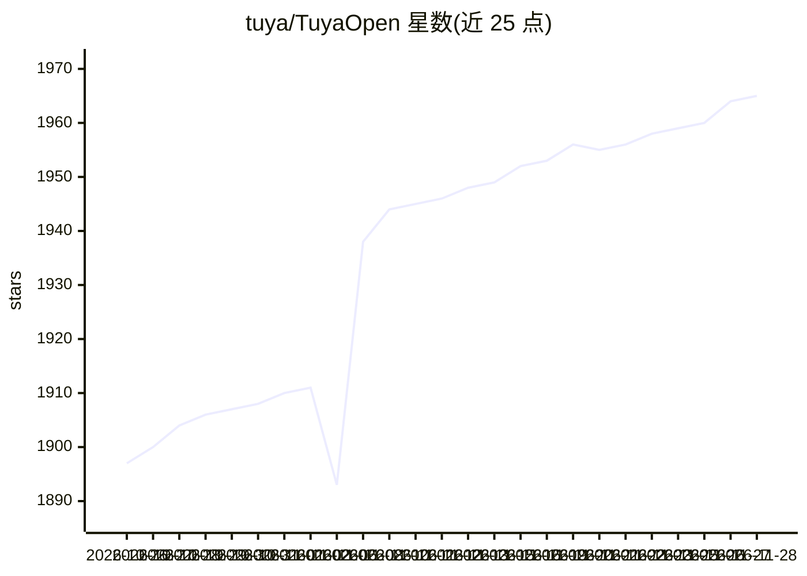

# tuya/TuyaOpen

⭐ 1,965 · C · NOASSERTION · 推送 2026-11-27 · [GitHub](https://github.com/tuya/TuyaOpen) · [官网](https://tuyaopen.ai) · 组织维护 · 中文 README

**面向 IoT 硬件开发者的开源 AI Agent 跨平台 C/C++ SDK**

涂鸦智能发布的跨平台 C/C++ SDK，用于开发带 AI 能力的硬件产品：支持 Tuya T 系列、T5、ESP32 及 Ubuntu/Linux 主机等目标平台，提供语音类功能（ASR/KWS/TTS/STT）、多模态能力（语音/视觉/传感器）开发，可接入多个 LLM 服务并对接 Tuya Cloud 实现远程控制、监控与 OTA，支持 Google Home 与 Amazon Alexa 兼容设备开发，内置安全、设备认证与数据加密。Apache-2.0 许可，含第三方子模块并附免责声明。

## 筛选速览

| 维度 | 判定 | 备注 |
|---|---|---|
| AI 角色 | `ai-ecosystem` | LLM/agent 周边工具 |
| 许可风险 | `none` | NOASSERTION |
| 部署形态 | `None` |  |
| 模型依赖 | locked-api |  |
| 硬件要求 | — | 无带数字的原话,不猜 |
| 安装摩擦 | `low` | 无编译、无系统依赖或容器化 |
| 成熟度 | — | 结构信号不足 |

## 能力要点

- 跨平台 C/C++ SDK，支持 Ubuntu、T3/T5、ESP32 系列目标平台
- 提供 ASR/KWS/TTS/STT 语音技术开发能力
- 可接入 Deepseek/ChatGPT/Claude/Gemini 等 LLM 服务
- 支持蓝牙/Wi-Fi/以太网及 Tuya Cloud 远程控制与 OTA

## 适用场景

- 开发带语音交互的智能硬件产品
- 为 ESP32/T5 开发板构建 AI Agent 设备
- 做需要云端远程控制和 OTA 的智能家居产品
- 开发兼容 Google Home / Amazon Alexa 的设备

## 场景标签

`聊天机器人` `语音合成` `语音识别` `多模态` · 领域:对话与助手

## 证据(README 行号)

> L35: TuyaOpen powers next-gen AI-agent hardware: it supports gear (Tuya T-Series WIFI/BT MCUs, Pi, ESP32s) via its flexi
> L41: - Integrate with leading LLMs and AI platforms, including `Deepseek`, `ChatGPT`, `Claude`, `Gemini`, and more.
> L56: |Name|Support Status|Introduction|Debug log serial port|

## 星数曲线

2026-10-26 1,897 → 2026-11-28 1,965（+68）

---
*卡片 v1 · prompt 1.4 · 生成 2026-11-24 · 置信度 high · 依据 README sha `4038e5d87692` · [字段定义](../../DATASET.md)*
