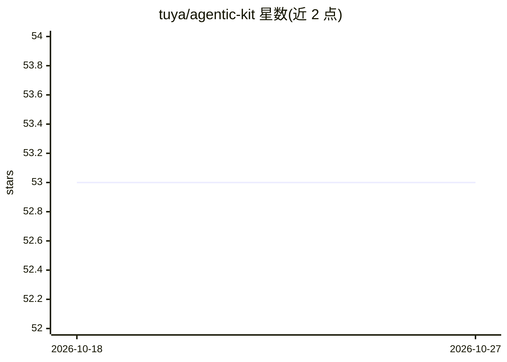

# tuya/agentic-kit

⭐ 53 · C · Apache-2.0 · 推送 2026-10-22 · [GitHub](https://github.com/tuya/agentic-kit) · [官网](https://agentic-kit.tuya.com) · 组织维护 · 中文 README

**智能硬件接入 Tuya AI 平台的端侧多模态 C SDK**

Tuya 官方提供的物联网设备端 SDK，使嵌入式设备接入 Tuya AI 云端平台，实现语音/文本对话、图片理解与生成，并支持设备侧 MCP 协议。附带 IoT Client（设备激活、MQTT、DP 数据点管理）、OTA 云端协议、AI 角色业务 API 与 BLE 配网等模块。芯片与操作系统无关，支持 macOS/Linux/FreeRTOS(ESP32)/MIPS/ARM；RTC UDP 客户端以预编译静态库形式提供，TCP 客户端开源。使用 CMake 从源码编译构建。

## 筛选速览

| 维度 | 判定 | 备注 |
|---|---|---|
| AI 角色 | `ai-ecosystem` | LLM/agent 周边工具 |
| 许可风险 | `permissive` | Apache-2.0 |
| 部署形态 | `None` |  |
| 模型依赖 | — | README 未给出锁定关系 |
| 硬件要求 | — | 无带数字的原话,不猜 |
| 安装摩擦 | `medium` | 含编译或系统依赖之一 |
| 成熟度 | — | 结构信号不足 |

## 能力要点

- 语音对话与图片理解/生成的多模态能力接入
- 设备侧 MCP（Model Context Protocol）支持
- 数据点管理（schema 校验/本地缓存/批量上报/状态持久化）与 OTA 云端协议
- 跨平台：macOS、Linux、FreeRTOS (ESP32)、MIPS、ARM

## 适用场景

- 嵌入式开发者让 IoT 设备接入云端 AI 对话与图像能力
- 通过设备侧 MCP 将智能硬件接入 agent 生态
- 在 ESP32 等芯片上实现带 AI 能力的语音硬件产品

## 场景标签

`多模态` · 领域:感知与多模态

## 证据(README 行号)

> L3: 智能硬件接入 Tuya AI 平台的多模态端侧 SDK，支持语音对话、图片理解/生成、设备侧 MCP。
> L9: - 设备侧 MCP（Model Context Protocol）支持

## 星数曲线

2026-10-18 53 → 2026-10-27 53（+0）

---
*卡片 v1 · prompt 1.4 · 生成 2026-10-24 · 置信度 high · 依据 README sha `67d65d967129` · [字段定义](../../DATASET.md)*
