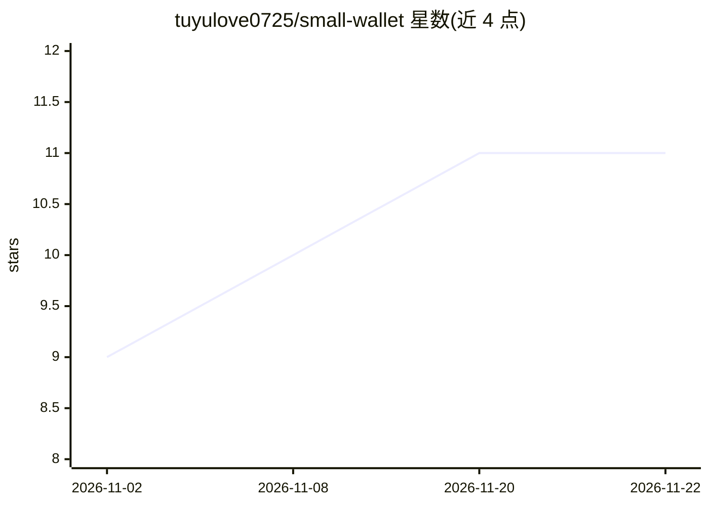

# tuyulove0725/small-wallet

⭐ 11 · MIT · 推送 2026-11-02 · [GitHub](https://github.com/tuyulove0725/small-wallet) · 个人维护 · 中文 README

**教 AI agent 用浏览器与支付宝 AI 付完成购物的实战教程**

一篇第一人称教程式 README，记录作者让 AI agent 花钱的两条路径：其一是用带调试端口的浏览器加 MCP 自动化层读取页面、找元素、提交订单，依赖登录态与小额免密，最终卡在短信验证码；其二是支付宝 AI 付（alipay-bot），先 apply-wallet 认领机器身份，再用 submit-payment 带 --payment-link 参数提交，由人扫码按指纹完成最后确认。还记录了桥接参数名、execFile 引号、收银台跳转等踩坑细节。

## 筛选速览

| 维度 | 判定 | 备注 |
|---|---|---|
| AI 角色 | `ai-knowledge` | 知识聚合/清单类 |
| 许可风险 | `permissive` | MIT |
| 部署形态 | `desktop` | 安装包/桌面程序 |
| 模型依赖 | — | README 未给出锁定关系 |
| 硬件要求 | — | 无带数字的原话,不猜 |
| 安装摩擦 | `low` | 无编译、无系统依赖或容器化 |
| 成熟度 | — | 结构信号不足 |

## 能力要点

- 浏览器自动化路径：Edge/Chrome 开 CDP 调试端口加 MCP 读页面、点元素
- 支付宝 AI 付路径：apply-wallet 认领 + submit-payment 提交，人扫码确认
- 记录 --payment-link 参数名缺失导致的报错排查过程
- 给出从零搭建的 7 步清单与桥接（execFile/execSync）引号坑

## 适用场景

- 想让自己的 agent 在淘宝/拼多多下单购物
- 接入支付宝 AI 付并理解认领与提交流程
- 排查浏览器自动化中页面结构与收银台跳转问题

## 场景标签

`浏览器自动化` `教程课程` · 领域:效率与自动化

## 证据(README 行号)

> L9: 这篇写的是我怎么搭起来的，和它到底卡在哪。
> L71: ## 八、从零开始要什么
> L98: ## 十、另一条路：AI 付

## 星数曲线

2026-11-02 9 → 2026-11-22 11（+2）

---
*卡片 v1 · prompt 1.4 · 生成 2026-11-19 · 置信度 high · 依据 README sha `682e3ad51d74` · [字段定义](../../DATASET.md)*
