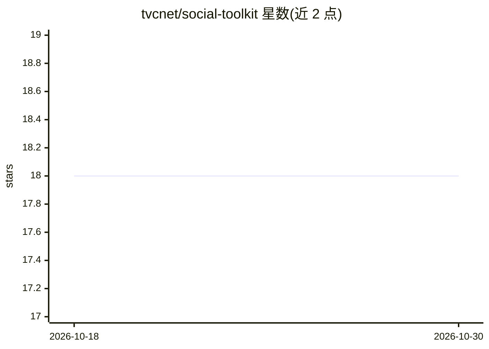

# tvcnet/social-toolkit

⭐ 18 · JavaScript · 推送 2026-03-24 · [GitHub](https://github.com/tvcnet/social-toolkit) · [官网](https://www.reddit.com/r/tvcnet/comments/1rummzc/tvcnet_socialtoolkit_made_for_tvcnet_website/) · 组织维护

**浏览器单文件社媒文案生成器：面向非营利组织与小微企业**

单个 HTML 文件运行的社媒内容草稿工具，无后端、无数据库、无需安装，用户在浏览器中填写 5W 框架（人物/事件/地点/原因/时间）后由所选 AI 提供方生成符合平台字数限制的帖子，支持 X、Instagram、Facebook、Threads、TikTok、Bluesky、LinkedIn 七个平台。AI 提供方包括 Google Gemma 3 27B、OpenAI GPT-5 Nano、Anthropic Claude 3.5 Haiku 与本地 Ollama。API 密钥与内容日历存于浏览器本地存储，支持图片视觉上下文、CSV 导出与一键直达发布框；不连接社媒账号、不代发帖，数据清空浏览器缓存即丢失。

## 筛选速览

| 维度 | 判定 | 备注 |
|---|---|---|
| AI 角色 | `ai-native` | 本体是模型或模型工具 |
| 许可风险 | `none` | — |
| 部署形态 | `None` |  |
| 模型依赖 | local-ok | 支持本地模型 |
| 硬件要求 | — | 无带数字的原话,不猜 |
| 安装摩擦 | `low` | 无编译、无系统依赖或容器化 |
| 成熟度 | — | 结构信号不足 |

## 能力要点

- 单一 HTML 文件在浏览器本地运行，无需安装、无后端
- 四家 AI 提供方可切换，含本地 Ollama（免费、可离线）
- 按平台字数限制自动生成 7 个平台的帖子
- 内容日历、CSV 导出与 API 设置备份/恢复

## 适用场景

- 没有营销团队的非营利组织持续产出社媒内容
- 小微企业免订阅维护专业社媒形象
- 偏好隐私、不愿把数据交给云端服务的运营者生成帖子草稿

## 场景标签

`AI 写作` · 领域:内容生成

## 证据(README 行号)

> L10: > Generate social media posts using the AI provider of your choice — no subscription, no login, no data collection.
> L45: |Multi-AI Support|Claude 3.5 Haiku, GPT-5 Nano, Gemma 3 27B, and local Ollama models|

## 星数曲线

2026-10-18 18 → 2026-10-30 18（+0）

---
*卡片 v1 · prompt 1.4 · 生成 2026-10-29 · 置信度 high · 依据 README sha `627cb409316f` · [字段定义](../../DATASET.md)*
