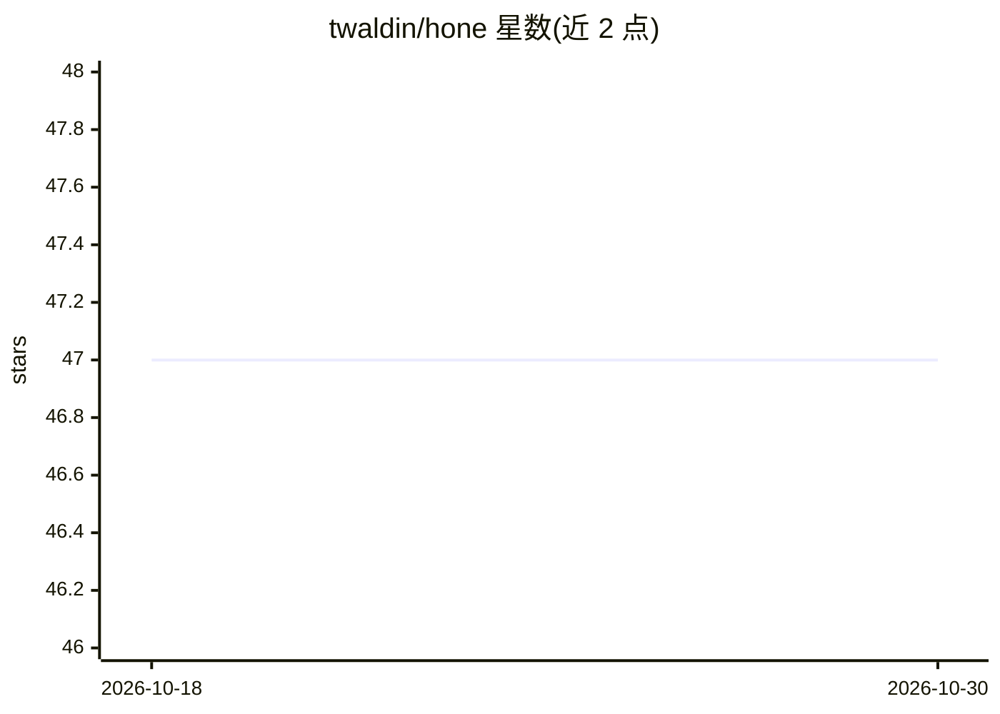

# twaldin/hone

⭐ 47 · TypeScript · MIT · 推送 2026-10-07 · [GitHub](https://github.com/twaldin/hone) · 个人维护

**研究性代码优化引擎：在预算内用模型提议改动、可信代码评分留优**

将任务打包为 capsule（含目标、评估器、预算、沙箱限制），模型驱动的 optimizer 在沙箱中编辑可变文件，独立的 broker 在固定容器镜像中运行评估器并强制执行预算，仅保留可信测量优于基线的候选，写代码的一方不给自己的工作打分。任务本体在 twaldin/hone-capsules 仓库。另支持 campaign 与递归模式（外层 optimizer 编辑内层 optimizer）。README 声明这是研究代码，尚非打包工具：多数结果未经独立复现，部分任务输入私有，跨任务迁移未测量。

## 筛选速览

| 维度 | 判定 | 备注 |
|---|---|---|
| AI 角色 | `ai-ecosystem` | LLM/agent 周边工具 |
| 许可风险 | `permissive` | MIT |
| 部署形态 | `library` | 以包/库形式分发 |
| 模型依赖 | — | README 未给出锁定关系 |
| 硬件要求 | — | 无带数字的原话,不猜 |
| 安装摩擦 | `low` | 无编译、无系统依赖或容器化 |
| 成熟度 | `idea` | |

## 能力要点

- optimizer 与评估器的信任分离：模型提议、可信代码测量、按预算记账
- capsule 准入要求评估器正确排序四个参考解（含必须不得获胜的捷径解）
- 支持 campaign 与递归优化模式，评估记录写入持久 journal
- 交付默认关闭，需显式投递到仓库

## 适用场景

- 在有固定可测目标（延迟、求解质量）的代码上跑优化实验
- 对 optimizer 本身进行跨冻结任务集的 campaign 实验
- 研究自改进 optimizer 在未见任务上的迁移表现

## 场景标签

`编码 Agent` · 领域:编码与开发

## 证据(README 行号)

> L3: Hone is an experimental engine for improving code against a fixed, measurable objective. You give it a task with a b
> L27: 2. **Proposal.** The **optimizer** (`optimizer/`) asks a model-backed coding worker to edit the mutable files insid
> L28: 3. **Measurement.** The **broker** (`trusted/broker/`) runs the evaluator in the pinned image, enforces the budget 

## 星数曲线

2026-10-18 47 → 2026-10-30 47（+0）

---
*卡片 v1 · prompt 1.4 · 生成 2026-10-25 · 置信度 mid · 依据 README sha `752c33fdd39a` · [字段定义](../../DATASET.md)*
