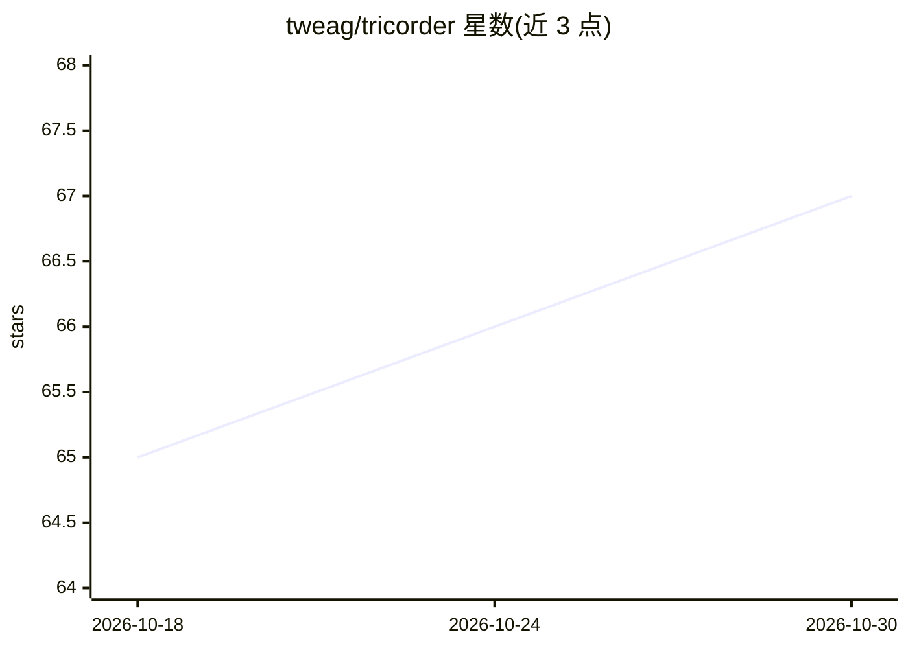

# tweag/tricorder

⭐ 67 · Haskell · MIT · 推送 2026-10-29 · [GitHub](https://github.com/tweag/tricorder) · 组织维护

**Haskell 开发反馈工具：持续构建、诊断并服务人类与 LLM agent**

面向 Haskell 开发者（含 LLM 编码 agent）的持续构建与反馈 CLI：后台守护进程持续构建代码、呈现诊断并运行测试，多个客户端（TUI、status 命令）通过 socket 共享同一守护进程避免重复构建。提供面向人类的 `tricorder ui` 实时 TUI、面向 agent 的 SKILL 说明、`status --json` 机器可读输出、依赖源码查询与多包项目自动发现。支持 cabal/stack 项目，通过 Hackage/Stackage、Nix 或预编译二进制安装，仅支持 Linux 与 macOS。

## 筛选速览

| 维度 | 判定 | 备注 |
|---|---|---|
| AI 角色 | `ai-ecosystem` | LLM/agent 周边工具 |
| 许可风险 | `permissive` | MIT |
| 部署形态 | `None` |  |
| 模型依赖 | — | README 未给出锁定关系 |
| 硬件要求 | — | 无带数字的原话,不猜 |
| 安装摩擦 | `low` | 无编译、无系统依赖或容器化 |
| 成熟度 | — | 结构信号不足 |

## 能力要点

- 后台守护进程构建，多客户端共享构建状态
- 面向 agent 的 SKILL 与 `--json` 机器可读输出
- 多包项目（cabal.project/stack.yaml）自动发现组件并构建测试
- `tricorder source` 从磁盘查找依赖源码以探索库 API

## 适用场景

- Haskell 项目开发中持续获取构建状态与诊断
- 让 Claude Code、Copilot 等编码 agent 通过 CLI 查询构建与测试反馈
- 多包 Haskell 项目的统一构建与测试运行

## 场景标签

 · 领域:开发者工具/Haskell

## 证据(README 行号)

> L3: Tricorder aims to empower users developing programs with Haskell and LLM
> L17: - **Designed for agents** - A `SKILL` is provided to inform agentic usage via
> L52: For using Tricorder with Claude Code, Copilot, or another coding agent, see

## 星数曲线

2026-10-18 65 → 2026-10-30 67（+2）

---
*卡片 v1 · prompt 1.4 · 生成 2026-10-24 · 置信度 high · 依据 README sha `1dc20d55818b` · [字段定义](../../DATASET.md)*
