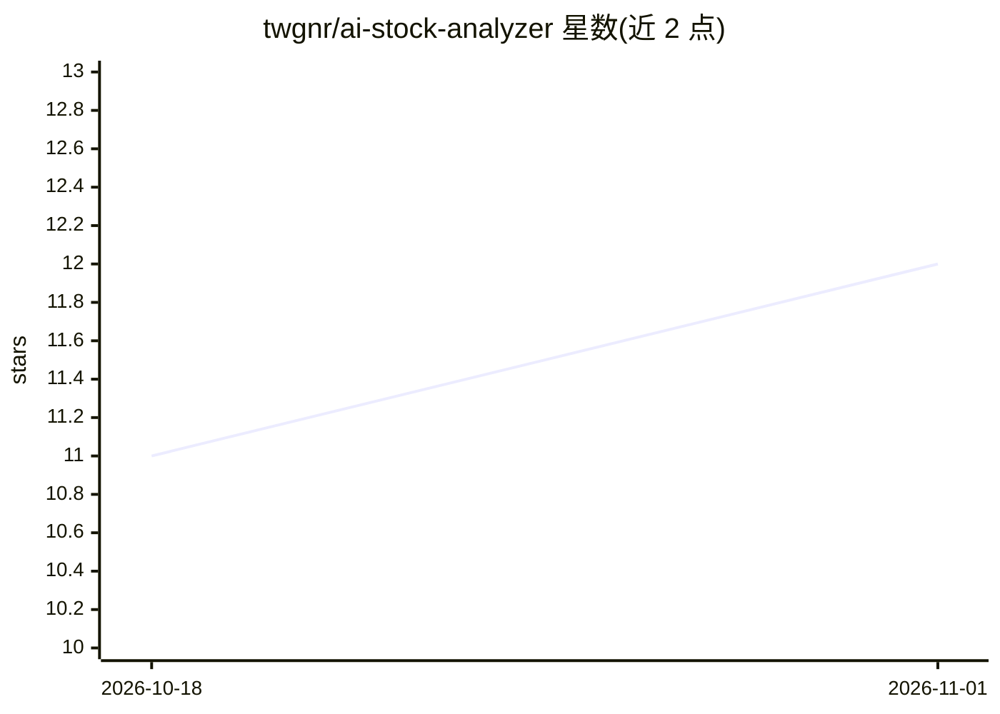

# twgnr/ai-stock-analyzer

⭐ 12 · TypeScript · MIT · 推送 2026-05-12 · [GitHub](https://github.com/twgnr/ai-stock-analyzer) · 个人维护 · 中文 README

**自托管 AI 股票研究与组合管理 PWA 应用**

基于 Next.js 16/React 19/MongoDB 的自托管股票研究与投资组合管理 Web 应用，面向个人投资者：覆盖持仓与交易记录（含券商 CSV 导入）、TWR/MWR 绩效与风险分析、观察列表与价格/指标告警、市场雷达与宏观情绪、选股器与回测、股息规划与税务导出。AI 部分提供多供应商 LLM 后端（Claude/Gemini/OpenAI/Groq 任意组合），按股票或组合生成多空综述、DCF 估值、RAG 对话问答、每周简报等分析，含 AI 建议追踪记录。以 PWA 形式安装，支持德/英双语，需自备各供应商 API key，生产部署需自行配置 TLS、备份与许可数据源。

## 筛选速览

| 维度 | 判定 | 备注 |
|---|---|---|
| AI 角色 | `ai-native` | 本体是模型或模型工具 |
| 许可风险 | `permissive` | MIT |
| 部署形态 | `library` | 以包/库形式分发 |
| 模型依赖 | locked-api |  |
| 硬件要求 | — | 无带数字的原话,不猜 |
| 安装摩擦 | `low` | 无编译、无系统依赖或容器化 |
| 成熟度 | — | 结构信号不足 |

## 能力要点

- 多供应商 LLM 后端（Claude/Gemini/OpenAI/Groq 任意组合），用户级 API key 加密存储
- 按股票/组合的 AI 分析：多空综述、DCF、关系图谱、RAG 问答、AI 建议追踪
- 组合管理全功能：TWR/MWR 绩效、风险因子、再平衡建议、券商 CSV 自动识别导入
- PWA 可安装、离线外壳与推送通知，GDPR 数据导出/删除与 TOTP 2FA

## 适用场景

- 集中管理持仓、交易、观察列表与告警，替代分散的多个工具
- 让 AI 对单只股票或整个组合生成多空综述与估值分析
- 跑策略回测并对照 AI 建议的历史准确度
- 自托管部署，掌控个人投资数据与 API key

## 场景标签

`金融量化` `RAG` · 领域:知识与检索

## 证据(README 行号)

> L3: A self-hosted, AI-assisted equity research and portfolio management app built with Next.js 16, React 19, MongoDB, an
> L36: ### AI analysis (per stock and per portfolio)

## 星数曲线

2026-10-18 11 → 2026-11-01 12（+1）

---
*卡片 v1 · prompt 1.4 · 生成 2026-11-01 · 置信度 high · 依据 README sha `a92b82fa6341` · [字段定义](../../DATASET.md)*
