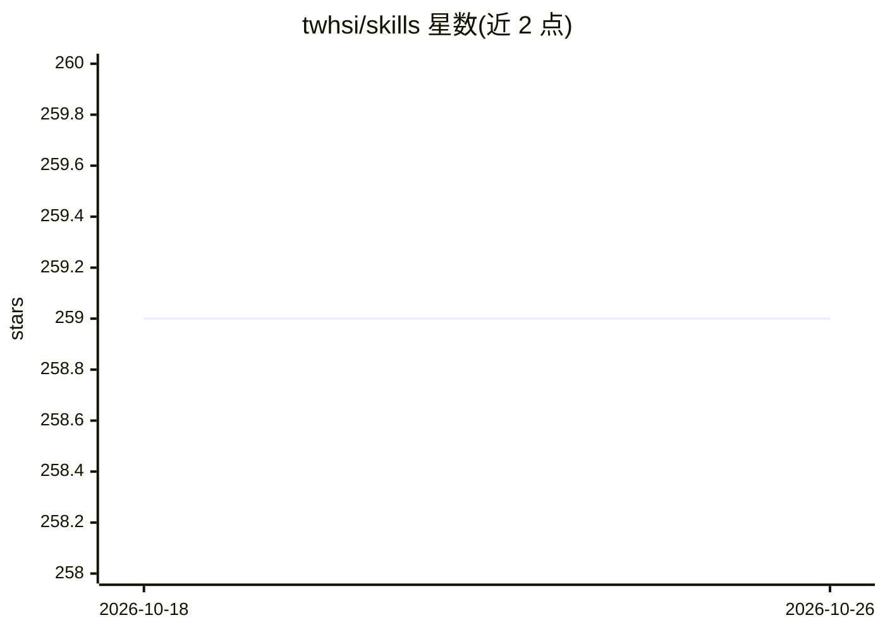

# twhsi/skills

⭐ 259 · Python · 推送 2026-07-21 · [GitHub](https://github.com/twhsi/skills) · [官网](https://www.twhsi.com/) · 个人维护 · 中文 README

**面向中文知识工作者的 AI Agent 技能注册表：写作/规划/出版工作流**

GitHub 托管的 agent 技能注册表，把周回顾、iMandalArt 九宫压缩、FIRE 语义分析、卡片笔记、EPUB 出版、A4 八页小书等长期工作流转为可被 Claude Code、Codex、ChatGPT 等 LLM agent 重复执行的 SKILL.md 过程。网站生成 agent.json、skills.json、llms.txt 等机器可读清单与安装命令、版本与更新时间戳。旗舰工作流"三大天王 2.2"：imandalart 压缩素材、BIRD 生成知识地址与 Route、A4 八页小书输出可打印 PDF/DOCX。限制：面向 CJK 工作流优化。

## 筛选速览

| 维度 | 判定 | 备注 |
|---|---|---|
| AI 角色 | `ai-knowledge` | 知识聚合/清单类 |
| 许可风险 | `none` | — |
| 部署形态 | `None` |  |
| 模型依赖 | — | README 未给出锁定关系 |
| 硬件要求 | — | 无带数字的原话,不猜 |
| 安装摩擦 | `low` | 无编译、无系统依赖或容器化 |
| 成熟度 | — | 结构信号不足 |

## 能力要点

- iMandalArt 2.2：把混杂素材压成一中心八视角、固定 11 行文本的九宫卡
- BIRD 2.1 协议：Book Address、Route、Deep Link 的可定位知识节点
- A4 八页小书：从 BookletManifest 2.0 生成阅读 PDF、折页打印版、DOCX 与验证报告
- 网站部署时生成 agent.json / skills.json / llms.txt 机器可读清单与版本、更新时间戳

## 适用场景

- 让 Claude Code/Codex 等 agent 按技能重复执行我的写作、规划与笔记工作流
- 把读书笔记拆成 BIRD 地址与 Route 并出版成 A4 折页小书
- 做以幸福与平静为中心的每周反向回顾规划

## 场景标签

`提示工程` `工作流自动化` `知识库管理` `AI 写作` · 领域:Agent 开发

## 证据(README 行号)

> L15: `twhsi/skills` is an installable, shareable, LLM-readable skill registry. It turns long-running workflows for weekl
> L154: - A GitHub-backed skill registry for Chinese agent workflows.

## 星数曲线

2026-10-18 259 → 2026-10-26 259（+0）

---
*卡片 v1 · prompt 1.4 · 生成 2026-10-22 · 置信度 high · 依据 README sha `05db3b7067b8` · [字段定义](../../DATASET.md)*
