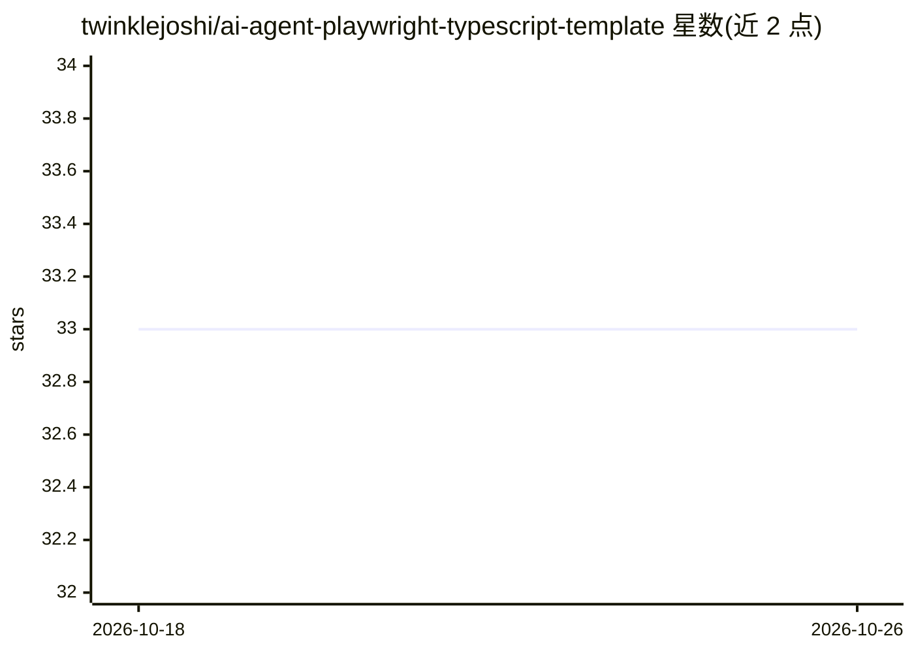

# twinklejoshi/ai-agent-playwright-typescript-template

⭐ 33 · TypeScript · Apache-2.0 · 推送 2026-05-25 · [GitHub](https://github.com/twinklejoshi/ai-agent-playwright-typescript-template) · 个人维护

**面向团队的 Playwright + TypeScript 测试自动化模板**

基于严格模式 TypeScript 与 Page Object Model 的 Playwright 测试模板：覆盖 UI/API 测试、按环境的 dotenv 配置、交互式 CLI 测试运行器、自定义 HTML 报告（含 JIRA 一键建 Bug）、标签驱动选择执行、文件日志、Jenkins CI 管道与质量工具链（ESLint/Prettier/Husky）。AI 相关部分为集成 Playwright MCP 与 Playwright agents 的 agentic 扩展能力。通过 git clone 与 npm 脚本安装运行。

## 筛选速览

| 维度 | 判定 | 备注 |
|---|---|---|
| AI 角色 | `ai-enhanced` | 去掉 AI 部分产品仍成立 |
| 许可风险 | `permissive` | Apache-2.0 |
| 部署形态 | `desktop` | 安装包/桌面程序 |
| 模型依赖 | — | README 未给出锁定关系 |
| 硬件要求 | — | 无带数字的原话,不猜 |
| 安装摩擦 | `low` | 无编译、无系统依赖或容器化 |
| 成熟度 | — | 结构信号不足 |

## 能力要点

- Page Object Model 组织 UI/API/E2E 测试结构
- 交互式 CLI 运行器动态组装 Playwright 命令（环境/浏览器/类型/标签/模式）
- 自定义 HTML 报告含 JIRA 一键创建 Bug 与内嵌产物
- Jenkins 管道使用官方 Playwright Docker 镜像执行

## 适用场景

- 团队快速搭建 Playwright 测试项目而不从零配置
- 通过交互式运行器选择环境与标签执行回归/冒烟测试
- CI 中运行测试并向 JIRA 自动创建缺陷

## 场景标签

 · 领域:软件测试/自动化

## 证据(README 行号)

> L3: Production-ready Playwright test automation starter for teams and startups: strict TypeScript, Page Object Model, en
> L38: |Agentic Ready|Integrated Playwright MCP and Playwright agents|

## 星数曲线

2026-10-18 33 → 2026-10-26 33（+0）

---
*卡片 v1 · prompt 1.4 · 生成 2026-10-25 · 置信度 mid · 依据 README sha `9501d22470ca` · [字段定义](../../DATASET.md)*
