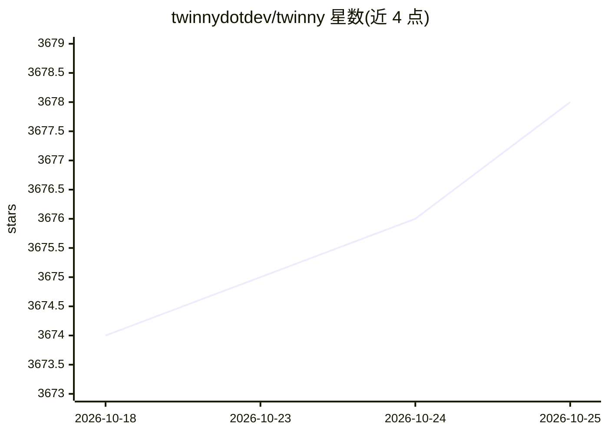

# twinnydotdev/twinny

⭐ 3,678 · TypeScript · MIT · 推送 2026-10-16 · [GitHub](https://github.com/twinnydotdev/twinny) · [官网](https://twinny.dev) · 个人维护 · 中文 README

**VS Code 本地/自托管 AI 编程助手：补全、编辑、聊天与代码审查**

MIT 许可的 VS Code 扩展，提供 fill-in-the-middle 代码补全、Ctrl+I 内联编辑（按 hunk 接受/拒绝）、可附文件与 git diff 的聊天、实验性 Agent 模式、混合关键词+向量检索的工作区索引、代码审查与 PR 审查、终端命令生成等功能。模型服务可自选：本机 Ollama/LM Studio/llama.cpp、其他设备的 P2P 加密直连、OpenAI/DeepSeek 等托管 API 或团队共享的 twinny-server 网关。网关对 5 人以内免费，更多席位及策略/录制/插件功能需付费许可。无遥测、无账号。

## 筛选速览

| 维度 | 判定 | 备注 |
|---|---|---|
| AI 角色 | `ai-native` | 本体是模型或模型工具 |
| 许可风险 | `permissive` | MIT |
| 部署形态 | `library` | 以包/库形式分发 |
| 模型依赖 | local-ok | 支持本地模型 |
| 硬件要求 | — | 无带数字的原话,不猜 |
| 安装摩擦 | `low` | 无编译、无系统依赖或容器化 |
| 成熟度 | `idea` | |

## 能力要点

- 补全/内联编辑/聊天/Agent 模式/代码审查/终端命令生成等编程功能
- 模型服务自选：本机、其他设备 P2P、托管 API 或团队网关，可混用
- twinny-server 团队网关：每开发者密钥、用量统计、策略与插件（许可功能）
- 工作区混合关键词+向量检索并在进入提示词前重排序

## 适用场景

- 在内网或本机模型上完成代码补全与编辑，数据不出网络
- 团队通过一个网关统一管理和审计所有开发者的 AI 用量
- 用本地模型做补全、托管模型做聊天的混合配置

## 场景标签

`代码生成` `代码审查` · 领域:编码与开发

## 证据(README 行号)

> L3: The AI coding assistant for Visual Studio Code that stays inside your network. Code completion, inline edits, chat, 
> L19: - **Code completion.** Fill-in-the-middle suggestions as you type, streamed as ghost text and stopped at a sensible

## 星数曲线

2026-10-18 3,674 → 2026-10-25 3,678（+4）

---
*卡片 v1 · prompt 1.4 · 生成 2026-10-20 · 置信度 high · 依据 README sha `2070051aec6f` · [字段定义](../../DATASET.md)*
