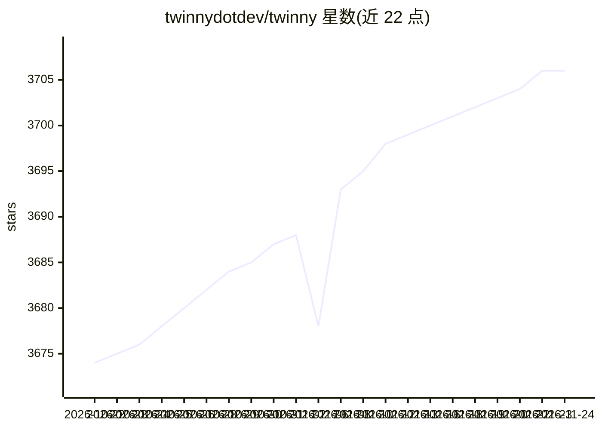

# twinnydotdev/twinny

⭐ 3,708 · TypeScript · MIT · 推送 2026-11-21 · [GitHub](https://github.com/twinnydotdev/twinny) · [官网](https://twinny.dev) · 个人维护 · 中文 README

**VS Code 内运行的 AI 编码助手，可用本地或托管模型**

以 VS Code 扩展形式提供的 AI 编码助手，功能包括代码补全、行内编辑（diff 审查后逐块接受）、代码对话（可附加文件/符号/git diff/终端）、实验性 Agent 模式（读写文件与运行命令）、工作区混合检索索引、代码审查与提交信息生成。模型可来自本地服务器、另一台设备的 GPU 点对点连接、托管 API 或团队网关 twinny-server。MIT 许可、无遥测、无登录；团队版超过五人后需购买席位许可解锁策略、录制与插件功能。

## 筛选速览

| 维度 | 判定 | 备注 |
|---|---|---|
| AI 角色 | `ai-native` | 本体是模型或模型工具 |
| 许可风险 | `permissive` | MIT |
| 部署形态 | `library` | 以包/库形式分发 |
| 模型依赖 | local-ok | 支持本地模型 |
| 硬件要求 | — | 无带数字的原话,不猜 |
| 安装摩擦 | `low` | 无编译、无系统依赖或容器化 |
| 成熟度 | — | 结构信号不足 |

## 能力要点

- 代码补全、行内编辑、对话、Agent 模式、代码审查与提交信息生成
- 支持本地服务器（Ollama/LM Studio/llama.cpp 等）、设备间点对点 GPU 共享、托管 API 与团队网关四种模型运行方式
- 工作区混合关键词与向量检索索引，按工作区隔离，回复展示来源
- twinny-server 网关提供每人密钥、用量统计、SSO、审计日志与 Helm 部署

## 适用场景

- 在内网环境用本地模型给 VS Code 加代码补全和对话
- 让 AI 基于工作区索引回答代码问题并附来源
- 对分支或 GitHub PR 做代码审查、从暂存区生成提交信息
- 团队共享一台 GPU 机器给多个开发者的编辑器提供模型服务

## 场景标签

`代码生成` `代码审查` `编码 Agent` · 领域:编码与开发

## 证据(README 行号)

> L3: The AI coding assistant for Visual Studio Code that stays inside your network. Code completion, inline edits, chat, 
> L19: - **Code completion.** Fill-in-the-middle suggestions as you type, streamed as ghost text and stopped at a sensible
> L34: |**On your machine**|Ollama, LM Studio, llama.cpp, QVAC, Oobabooga, LiteLLM, Open WebUI, or any OpenAI-compatible s

## 星数曲线

2026-10-22 3,674 → 2026-11-24 3,706（+32）

---
*卡片 v1 · prompt 1.4 · 生成 2026-11-23 · 置信度 high · 依据 README sha `8a32c0f6e8b9` · [字段定义](../../DATASET.md)*
