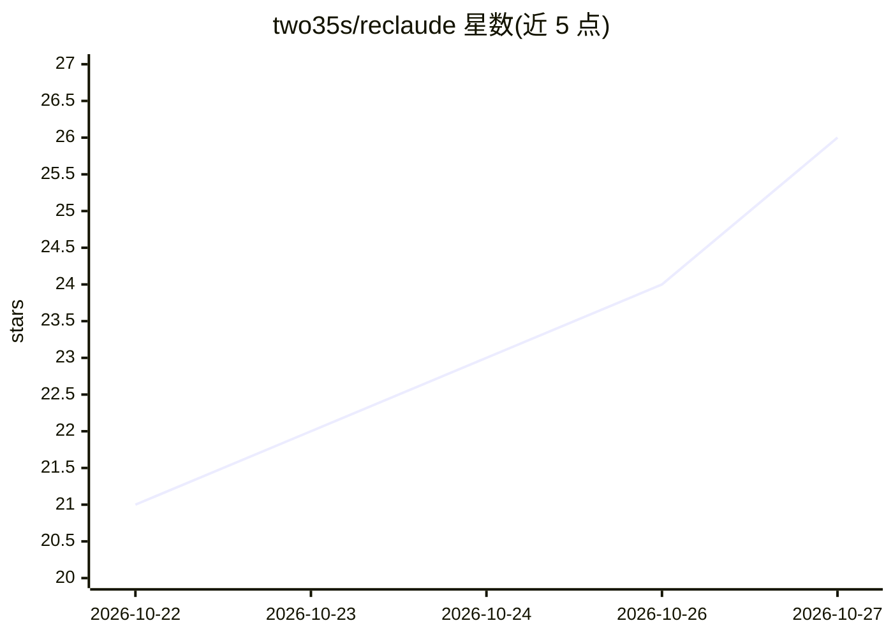

# two35s/reclaude

⭐ 26 · Python · 推送 2026-10-23 · [GitHub](https://github.com/two35s/reclaude) · 个人维护 · 中文 README

**复用浏览器会话在终端直连 Claude.ai/ChatGPT/Meta AI 的客户端与代理**

研究用途工具：从已登录的 Chrome 提取会话 Cookie（或经 CDP 自动抓取、手动粘贴），以用户自身账号访问 Claude.ai、chatgpt.com、meta.ai 的内部端点，流式返回回答，无需 API key。形态为终端 REPL/TUI 客户端、OpenAI 兼容代理（:8765 /v1）与 MCP 服务器三种入口；代理按模型 ID 路由三个后端，支持流式、多轮（X-Conversation-Id）与文本模拟的 OpenAI tool calling。README 警告此行为可能导致账号受限，建议使用可弃账号；账号限额与计费仍适用。

## 筛选速览

| 维度 | 判定 | 备注 |
|---|---|---|
| AI 角色 | `ai-ecosystem` | LLM/agent 周边工具 |
| 许可风险 | `none` | — |
| 部署形态 | `library` | 以包/库形式分发 |
| 模型依赖 | — | README 未给出锁定关系 |
| 硬件要求 | — | 无带数字的原话,不猜 |
| 安装摩擦 | `low` | 无编译、无系统依赖或容器化 |
| 成熟度 | — | 结构信号不足 |

## 能力要点

- 三种入口：终端 REPL/TUI、OpenAI 兼容代理、MCP 服务器
- 从 Chrome Cookie 库或 CDP 提取浏览器会话，免 API key
- 一个代理同时服务 Claude、ChatGPT（chatgpt/）、Meta AI（meta/）模型
- 文本模拟实现 OpenAI tool calling，避免原生工具通道死锁

## 适用场景

- 在终端里用自己账号的 Claude.ai/ChatGPT 直接对话
- 把 Claude.ai 会话作为 OpenAI 兼容模型接入 OpenCode 等客户端
- 让 agent 通过 MCP 工具调用 Claude/ChatGPT/Meta AI 而不切换模型提供商

## 场景标签

 · 领域:LLM 基础设施/客户端代理

## 证据(README 行号)

> L6: Terminal client for Claude.ai, ChatGPT, and Meta AI — replays your own browser session against their internal endpoi
> L21: si is three thin surfaces — a terminal client, an OpenAI-compatible proxy, and an MCP server — over three streaming

## 星数曲线

2026-10-22 21 → 2026-10-27 26（+5）

---
*卡片 v1 · prompt 1.4 · 生成 2026-10-27 · 置信度 mid · 依据 README sha `a19d6d03d638` · [字段定义](../../DATASET.md)*
