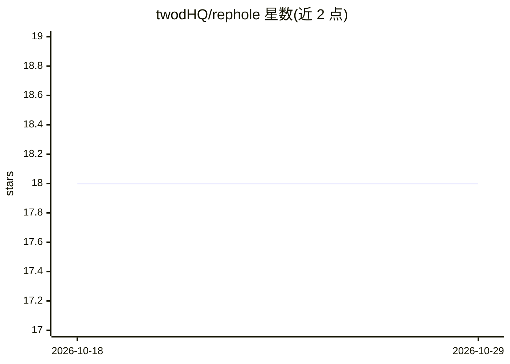

# twodHQ/rephole

⭐ 18 · TypeScript · Apache-2.0 · 推送 2025-12-12 · [GitHub](https://github.com/twodHQ/rephole) · [官网](https://rephole.twod.space) · 组织维护

**自托管 REST API：把代码库变成可语义检索的 RAG 服务**

开源的自托管 REST API 服务：接收仓库 URL 后自动克隆、基于 tree-sitter AST 解析（37 种语言）、按函数/类级别分块、用 OpenAI text-embedding-3-small 生成嵌入存入 ChromaDB，随后通过 REST 端点提供语义搜索（返回完整父文档或原始分块两种模式）。架构为 API 服务器 + BullMQ 后台 Worker 的生产者-消费者模式，依赖 PostgreSQL、Redis、Docker Compose 部署及 OpenAI API key。面向希望将代码语义检索能力集成进自家产品的开发者。

## 筛选速览

| 维度 | 判定 | 备注 |
|---|---|---|
| AI 角色 | `ai-ecosystem` | LLM/agent 周边工具 |
| 许可风险 | `permissive` | Apache-2.0 |
| 部署形态 | `self-host` | docker 或自建部署 |
| 模型依赖 | — | README 未给出锁定关系 |
| 硬件要求 | — | 无带数字的原话,不猜 |
| 安装摩擦 | `low` | 无编译、无系统依赖或容器化 |
| 成熟度 | — | 结构信号不足 |

## 能力要点

- tree-sitter AST 解析支持 37 种编程语言的函数/类级分块
- Parent-Child 检索：搜索小子块、返回完整父文档，另有原始分块端点
- 生产者-消费者架构（NestJS + BullMQ + Redis），支持 Worker 水平扩缩与失败重试
- 多仓库索引与自定义元数据过滤（团队/环境/标签）

## 适用场景

- 给内部工具或 AI 编程助手接入跨仓库的代码语义检索
- 用自然语言提问定位某段功能的实现位置
- 按团队、环境等元数据维度过滤检索特定服务的代码

## 场景标签

`语义搜索` · 领域:知识与检索

## 证据(README 行号)

> L10: Rephole is an open-source REST API that ingests your codebase and creates a specialized RAG (Retrieval-Augmented Ge
> L16: - 🔗 Integrate AI coding assistants into your own products

## 星数曲线

2026-10-18 18 → 2026-10-29 18（+0）

---
*卡片 v1 · prompt 1.4 · 生成 2026-10-29 · 置信度 mid · 依据 README sha `2db1dbe6341b` · [字段定义](../../DATASET.md)*
