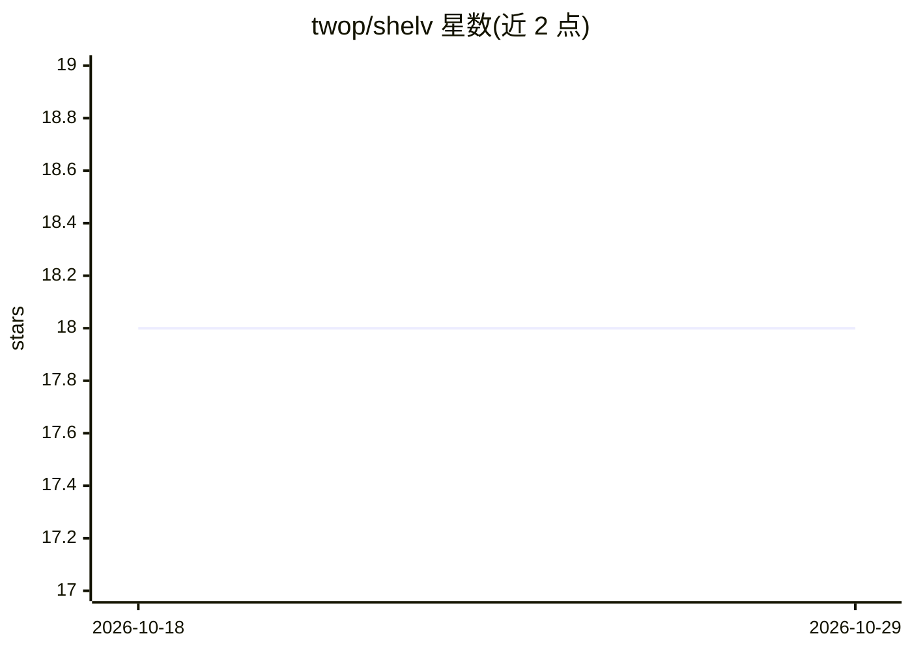

# twop/shelv

⭐ 18 · Rust · NOASSERTION · 推送 2026-10-27 · [GitHub](https://github.com/twop/shelv) · [官网](https://shelv.app) · 个人维护

**macOS 本地可脚本化纯文本笔记应用，内置 AI 快速提问**

用 Rust + egui 编写的 macOS 纯文本笔记应用：支持 CommonMark、代码高亮、笔记内可执行的 JavaScript 代码块（Boa 引擎）、KDL 语法的设置笔记（自定义命令与快捷键、实时重载）、Word Jump 键盘跳词导航。AI 部分为 Quick Prompt：对选中文本以当前笔记为上下文提问，通过 rust-genai 库接入 OpenAI/Anthropic/Gemini/Ollama 等多家模型。分发方式为 Mac App Store 或源码编译（Komorebi License 2.0.0，源码可用非完全开源）。

## 筛选速览

| 维度 | 判定 | 备注 |
|---|---|---|
| AI 角色 | `ai-enhanced` | 去掉 AI 部分产品仍成立 |
| 许可风险 | `none` | NOASSERTION |
| 部署形态 | `None` |  |
| 模型依赖 | local-ok | 支持本地模型 |
| 硬件要求 | — | 无带数字的原话,不猜 |
| 安装摩擦 | `low` | 无编译、无系统依赖或容器化 |
| 成熟度 | — | 结构信号不足 |

## 能力要点

- 设置即笔记：用 KDL + JavaScript 自定义命令与快捷键，实时重载
- 笔记内 JavaScript 代码块可直接运行并输出结果
- Quick Prompt：以当前笔记为上下文对选中文本提问，模型可配置
- 支持 OpenAI/Anthropic/Cohere/Gemini/Groq/Ollama/XAI/DeepSeek 多家 AI 提供商

## 适用场景

- 在本地纯文本笔记中记录并整理 Markdown 笔记与 TODO
- 通过自定义 KDL 命令和 JavaScript 函数扩展编辑行为
- 写作时用 Quick Prompt 向 AI 询问选中文本（可接本地 Ollama）
- 用两字符键盘序列快速跳转光标位置

## 场景标签

`知识库管理` · 领域:知识与检索

## 证据(README 行号)

> L5:  Shelv is scriptable, plain text notes app with integrated ai-features for macOS, written in Rust (btw (tm)).
> L30: - **Quick Prompt**: You can ask AI about your text selection, with the note as the context (the models are also con
> L237:  I'm sick of AI hype, is Shelv yet another AI-'something'?

## 星数曲线

2026-10-18 18 → 2026-10-29 18（+0）

---
*卡片 v1 · prompt 1.4 · 生成 2026-10-29 · 置信度 high · 依据 README sha `9fba2f420f54` · [字段定义](../../DATASET.md)*
