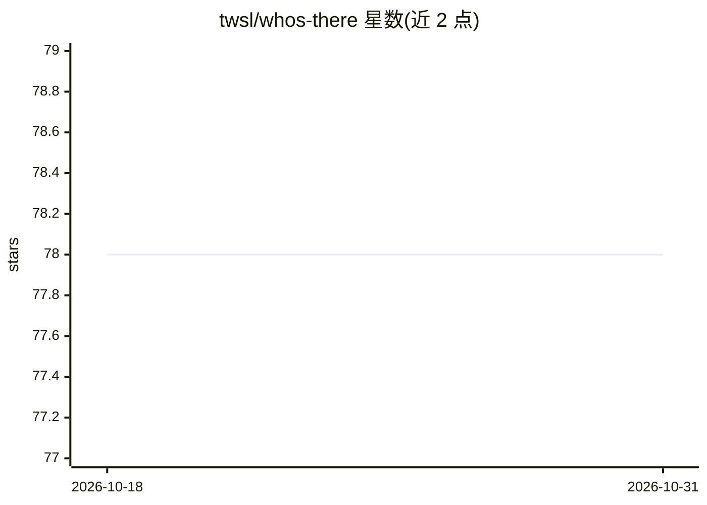

# twsl/whos-there

⭐ 78 · Python · MIT · 推送 2026-10-30 · [GitHub](https://github.com/twsl/whos-there) · [官网](https://twsl.github.io/whos-there/) · 个人维护

**PyTorch Lightning 训练通知回调：训练结束或崩溃时推送通知**

knockknock 的后继项目，以单个回调（NotificationCallback）集成到 PyTorch Lightning，在训练完成或中途崩溃时发送通知。支持 E-Mail(SMTP)、Discord、Slack、Teams、Telegram 五种发送渠道，每种渠道以独立 Sender 类配置（webhook URL、token、chat_id 等）。面向深度学习开发者，以 Python 包形式经 pip、uv 或 conda 安装使用，附带 DebugSender 调试通道。

## 筛选速览

| 维度 | 判定 | 备注 |
|---|---|---|
| AI 角色 | `ai-ecosystem` | LLM/agent 周边工具 |
| 许可风险 | `permissive` | MIT |
| 部署形态 | `library` | 以包/库形式分发 |
| 模型依赖 | — | README 未给出锁定关系 |
| 硬件要求 | — | 无带数字的原话,不猜 |
| 安装摩擦 | `low` | 无编译、无系统依赖或容器化 |
| 成熟度 | — | 结构信号不足 |

## 能力要点

- 单个 Callback 即可为 Lightning 训练过程附加通知
- 支持 E-Mail/Discord/Slack/Teams/Telegram 五种通知渠道
- 经 pip、uv、conda-forge 三种途径安装

## 适用场景

- 长时间训练结束后收到即时通知，无需盯守终端
- 训练崩溃时第一时间通过 Slack 或 Telegram 获知
- 在多个训练任务并行时通过消息渠道区分任务状态

## 场景标签

`MLOps` · 领域:训练与推理

## 证据(README 行号)

> L22: The spiritual successor to knockknock for PyTorch Lightning, to get a notification when your training is complete o
> L26: - Supports E-Mail, Discord, Slack, Teams, Telegram

## 星数曲线

2026-10-18 78 → 2026-10-31 78（+0）

---
*卡片 v1 · prompt 1.4 · 生成 2026-10-24 · 置信度 high · 依据 README sha `57c2bae6aa36` · [字段定义](../../DATASET.md)*
