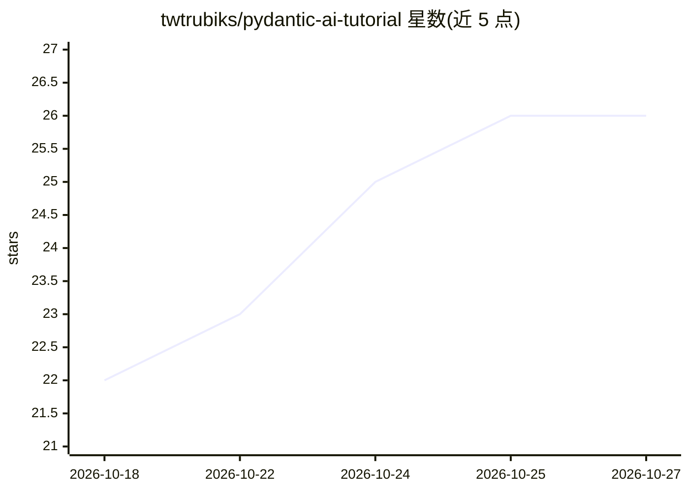

# twtrubiks/pydantic-ai-tutorial

⭐ 26 · Python · MIT · 推送 2026-10-20 · [GitHub](https://github.com/twtrubiks/pydantic-ai-tutorial) · 个人维护 · 中文 README

**Pydantic AI 框架的繁体中文示例教程：结构化输出与 Agent 开发**

介绍 Pydantic AI v2 框架的教学仓库，配套约 25 个可运行的 Python 示例：结构化输出三种模式、工具注册与重试、依赖注入、多代理协作、MCP Client 接入 Odoo、工具核准（Human-in-the-Loop）、网页聊天界面、Gemini Thinking 与 Embedding、串流输出、Claude Prompt Caching 与 Advisor 模式、纯 anthropic SDK 手写迷你 Claude Code、TestModel 零成本测试与 Pydantic Evals 评估等。示例分别使用 Anthropic Claude、Google Gemini、OpenRouter、NVIDIA NIM 作为模型来源，需在 .env 填入对应 API key。含与 LangChain、Instructor 的特性对比表及适用/不适用场景说明。

## 筛选速览

| 维度 | 判定 | 备注 |
|---|---|---|
| AI 角色 | `ai-knowledge` | 知识聚合/清单类 |
| 许可风险 | `permissive` | MIT |
| 部署形态 | `library` | 以包/库形式分发 |
| 模型依赖 | locked-api |  |
| 硬件要求 | — | 无带数字的原话,不猜 |
| 安装摩擦 | `low` | 无编译、无系统依赖或容器化 |
| 成熟度 | — | 结构信号不足 |

## 能力要点

- 覆盖结构化输出、多代理、MCP、工具核准等主题的可运行示例集
- 跨四家模型供应商（Anthropic/Google/OpenRouter/NVIDIA NIM）的对照示例
- 零成本测试（TestModel/FunctionModel）与 Pydantic Evals 评估示例
- 纯 anthropic SDK 手写迷你 Claude Code 的对照实现

## 适用场景

- 我想通过示例学习 Pydantic AI 的结构化输出与 Agent 开发
- 为生产级 LLM 应用选型时对照不同模型供应商的行为差异
- 了解工具核准、快取、评估等机制的具体实现方式

## 场景标签

`教程课程` · 领域:学习与行业

## 证据(README 行号)

> L7: * Youtube Tutorial - Pydantic AI - AI 開發的 FastAPI 時刻！告別混亂解析 & 燒錢測試
> L32: 本專案使用 **Pydantic AI v2**
> L36: pip install -r requirements.txt

## 星数曲线

2026-10-18 22 → 2026-10-27 26（+4）

---
*卡片 v1 · prompt 1.4 · 生成 2026-10-26 · 置信度 high · 依据 README sha `e91cac97cafe` · [字段定义](../../DATASET.md)*
