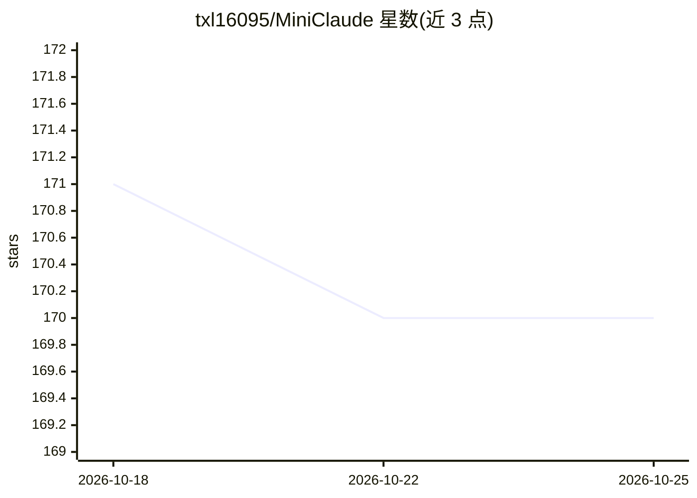

# txl16095/MiniClaude

⭐ 170 · TypeScript · NOASSERTION · 推送 2026-05-18 · [GitHub](https://github.com/txl16095/MiniClaude) · [官网](https://txl16095.github.io/MiniClaude/) · 个人维护 · 中文 README

**删除云服务的本地化 Claude Code 精简版编程助手**

由 Claude Code 删除约 92,000 行云服务/遥测/协作代码改造而来的 CLI 编程助手，保留 AI 对话、代码生成、文件操作、Git、LSP、MCP、插件与技能系统。支持多 Provider 热切换（如 DeepSeek，经 Anthropic 兼容接口配置），兼容 Claude Code 的 settings.json 配置体系。需 Bun>=1.3.11 与 Git，git clone 后 bun install/build 运行，MIT 许可。

## 筛选速览

| 维度 | 判定 | 备注 |
|---|---|---|
| AI 角色 | `ai-native` | 本体是模型或模型工具 |
| 许可风险 | `none` | NOASSERTION |
| 部署形态 | `None` |  |
| 模型依赖 | locked-api |  |
| 硬件要求 | — | 无带数字的原话,不猜 |
| 安装摩擦 | `low` | 无编译、无系统依赖或容器化 |
| 成熟度 | — | 结构信号不足 |

## 能力要点

- 删除 92,000 行云服务/遥测/协作代码，保留核心开发功能
- 多 Provider 热切换（/provider 命令，切换无需重启）
- 支持 MCP、插件、技能系统与 hard_deny 安全规则
- 完全兼容 Claude Code 配置体系（settings.json / .env）

## 适用场景

- 本地无遥测环境下使用 AI 编程助手写代码
- 按需在多个模型 Provider 间切换做开发
- 需要 MCP/插件扩展能力的 CLI 编程工作流

## 场景标签

`编码 Agent` · 领域:编码与开发

## 证据(README 行号)

> L10: ### 轻量级本地 AI 编程助手
> L24: 原版 **Claude Code** 删除了 **92,000 行**云服务/遥测/协作代码后得到 MiniClaude。
> L101: |AI 能力|智能对话 · 代码生成 · 项目理解 · 多模型 · 多 Provider 热切换|

## 星数曲线

2026-10-18 171 → 2026-10-25 170（-1）

---
*卡片 v1 · prompt 1.4 · 生成 2026-10-22 · 置信度 high · 依据 README sha `96ec87695d2f` · [字段定义](../../DATASET.md)*
