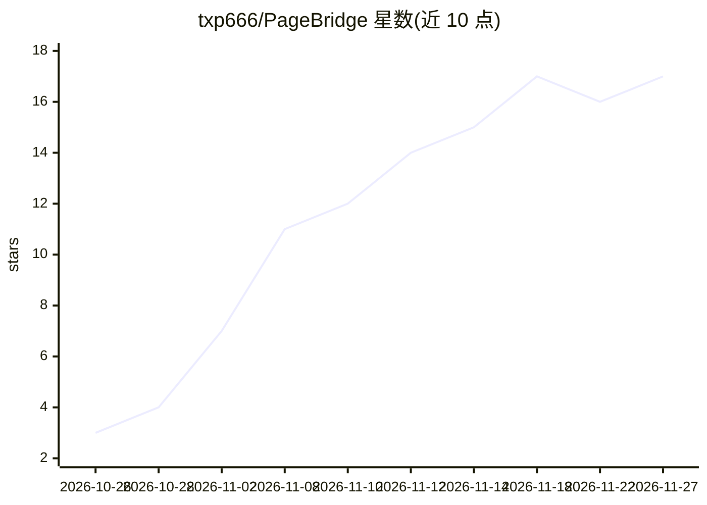

# txp666/PageBridge

⭐ 17 · Python · AGPL-3.0 · 推送 2026-11-19 · [GitHub](https://github.com/txp666/PageBridge) · [官网](https://pagebridge.modusignal.cn/) · 个人维护 · 中文 README

**Mac/Windows 原生 PDF 翻译、阅读批注与文档助手应用**

面向手册、报告、教材、合同和论文等 PDF 的原生桌面应用（Mac SwiftUI/PDFKit、Windows WinUI 3）。核心功能：MinerU 本机解析生成保留原页版式的阅读稿，支持整篇或指定页翻译、原译文对照、导出译文/双语 PDF，翻译走本机 Ollama 或 OpenAI 兼容 API；另含九种语言互译、领域术语表、批注导出、带页码引用的 AI 文档助手，以及 OpenAlex/Sci-Hub 文献搜索与全文获取。不包含语言模型，Ollama 需另行安装；Mac 仅支持 Apple Silicon，包未做开发者签名或公证。

## 筛选速览

| 维度 | 判定 | 备注 |
|---|---|---|
| AI 角色 | `ai-native` | 本体是模型或模型工具 |
| 许可风险 | `viral` | AGPL-3.0 |
| 部署形态 | `desktop` | 安装包/桌面程序 |
| 模型依赖 | local-ok | 支持本地模型 |
| 硬件要求 | — | 无带数字的原话,不猜 |
| 安装摩擦 | `low` | 无编译、无系统依赖或容器化 |
| 成熟度 | — | 结构信号不足 |

## 能力要点

- MinerU 本机解析生成原页版式阅读稿，可导出译文/双语 PDF
- 翻译用本机 Ollama 或 OpenAI 兼容 API，九种语言任意互译
- 内置九个领域术语表，支持导入导出与按术语重译
- AI 文档助手回答附页码引用；OpenAlex/Sci-Hub 文献搜索与全文导入

## 适用场景

- 阅读外文 PDF 时保留排版整篇翻译并对照阅读
- 管理论文等 PDF 文档并做批注、全库搜索
- 按 DOI 或标题搜索文献并获取全文导入文档库
- 向 AI 助手就当前文档提问并核对页码引用

## 场景标签

`文档问答` `科研工具` · 领域:知识与检索

## 证据(README 行号)

> L5: **Mac 与 Windows 原生 PDF 阅读、翻译工作区。** 整理文档、保留排版翻译、原译文对照、导出译文 PDF、批注和 AI 问答，也能搜索文献并打开全文。
> L7: 适用于手册、报告、教材、合同和论文等 PDF。Mac 使用 SwiftUI / AppKit / PDFKit，Windows 使用 WinUI 3。由 MinerU 在本机解析并生成原页版式阅读稿，可导出为译文 PDF 和双语 P
> L56: - **文档助手：** 独立选择已配置的模型，按文档、当前页、选文或自由提问；回答附可核对的页码引用，可保存为笔记。

## 星数曲线

2026-10-26 3 → 2026-11-27 17（+14）

---
*卡片 v1 · prompt 1.4 · 生成 2026-11-18 · 置信度 mid · 依据 README sha `32a773ece382` · [字段定义](../../DATASET.md)*
