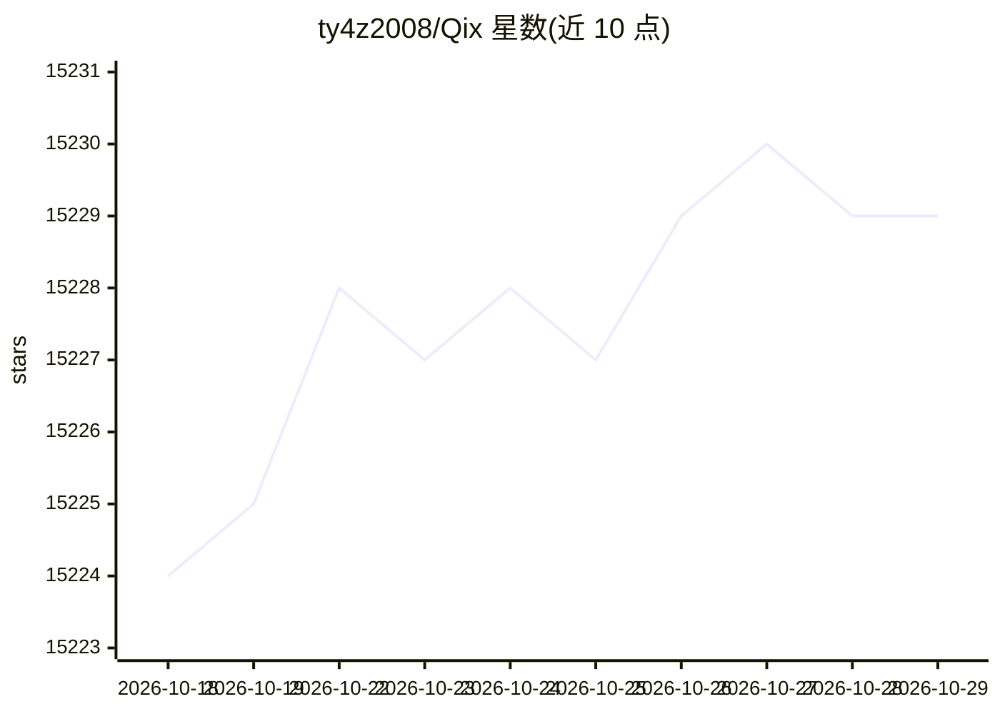

# ty4z2008/Qix

⭐ 15,229 · NOASSERTION · 推送 2026-09-06 · [GitHub](https://github.com/ty4z2008/Qix) · [官网](http://ty4z2008.github.io/Qix) · 个人维护 · 中文 README

**机器学习/分布式系统/Go/PostgreSQL 学习资源合集**

个人维护的学习资源仓库，按主题分章节组织：机器学习与深度学习资料、Golang 学习资源、PostgreSQL 数据库资源、分布式系统资源及数据库系统资源。另包含译者对 node-mysql 官方文档的中文翻译。作者声明文章可能存在不准确信息，欢迎通过邮件或 PR 反馈纠错；同时提醒使用者尊重原作署名，发现署名错误时提交反馈。仓库采用 MIT 许可证。

## 筛选速览

| 维度 | 判定 | 备注 |
|---|---|---|
| AI 角色 | `ai-knowledge` | 知识聚合/清单类 |
| 许可风险 | `none` | NOASSERTION |
| 部署形态 | `None` |  |
| 模型依赖 | — | README 未给出锁定关系 |
| 硬件要求 | — | 无带数字的原话,不猜 |
| 安装摩擦 | `low` | 无编译、无系统依赖或容器化 |
| 成熟度 | — | 结构信号不足 |

## 动量与使用信号

- 维护:`active` — 距上次 push 42.1 天,年发版 0,12 位贡献者
- 涨星:近 1 天 **+2**(自 20261016 起算)

## 能力要点

- 按章节组织机器学习/深度学习、Golang、PostgreSQL、分布式系统等主题资源
- 包含 node-mysql 官方文档中文翻译
- 开放 PR 协作与纠错反馈机制
- MIT 许可证

## 适用场景

- 查找机器学习与深度学习的中文学习资料
- 入门 Golang 与 PostgreSQL 时收集学习资源
- 查阅 node-mysql 文档的中文翻译

## 场景标签

`精选清单` · 领域:学习与行业

## 证据(README 行号)

> L27: ## Machine Learning And deep learning Resources
> L33: ## Golang learning resources
> L41: ## Distributed system resources

## 星数曲线

2026-10-18 15,224 → 2026-10-29 15,229（+5）

---
*卡片 v1 · prompt 1.4 · 生成 2026-10-18 · 置信度 mid · 依据 README sha `86aa03c88318` · [字段定义](../../DATASET.md)*
