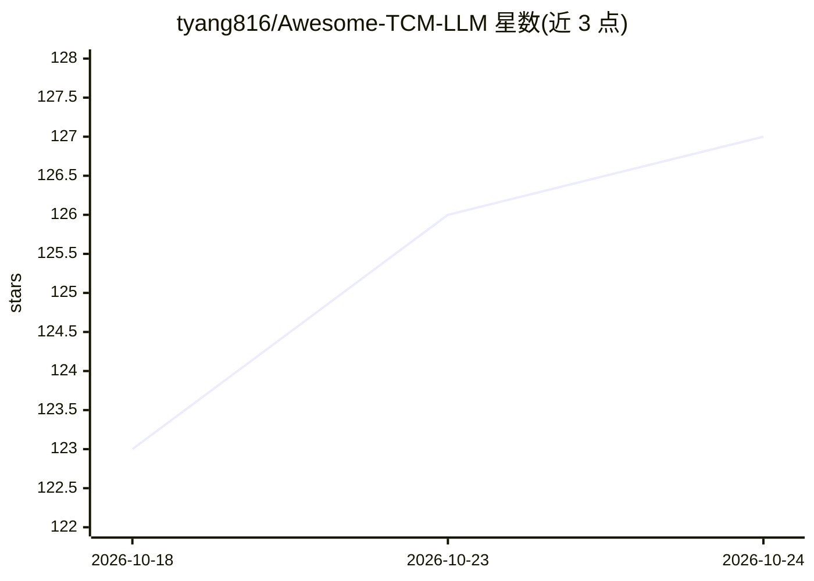

# tyang816/Awesome-TCM-LLM

⭐ 128 · Python · MIT · 推送 2026-10-24 · [GitHub](https://github.com/tyang816/Awesome-TCM-LLM) · 个人维护 · 中文 README

**开源中医大模型/数据集/论文/专利的策展清单**

个人维护的中医领域 awesome 类聚合仓库：收录约 111 个模型、180 个数据集、348 篇方法论文、71 篇综述、69 件专利与 55 条新闻，按开源模型（可下载权重 12 个）、仅论文/产品、通用中文医疗底座、闭源产品分层组织。提供按用途的选型表（本机复现、问诊、舌诊、继续训练、对比实验等），并标注同名不同源的模型与权重可下载性等核验信息。条目以链接形式指向论文、代码与模型权重。

## 筛选速览

| 维度 | 判定 | 备注 |
|---|---|---|
| AI 角色 | `ai-knowledge` | 知识聚合/清单类 |
| 许可风险 | `permissive` | MIT |
| 部署形态 | `None` |  |
| 模型依赖 | — | README 未给出锁定关系 |
| 硬件要求 | — | 无带数字的原话,不猜 |
| 安装摩擦 | `low` | 无编译、无系统依赖或容器化 |
| 成熟度 | — | 结构信号不足 |

## 能力要点

- 收录 111 个中医模型、180 个数据集、348 篇方法论文
- 标注可下载复现的权重仅约 12 个并单列
- 按任务（复现/问诊/舌诊/继续训练/对比实验）给出选型表
- 收录通用中文医疗底座模型（30 个）与闭源产品作对照

## 适用场景

- 找可下载复现的中医大模型权重
- 为中医微调实验挑选底座模型与对照基线
- 查找中医领域数据集、综述与评测基准
- 了解中医大模型领域的机构与产品分布

## 场景标签

`精选清单` · 领域:学习与行业

## 证据(README 行号)

> L1: # 🔥 开源中医模型、数据、论文、专利
> L7: 开源中医模型、数据、论文、专利精选，也带一点相关中文医疗。现在大概有 55 条新闻、111 个模型、71 篇综述、69 件专利、180 个数据集、348 篇方法论文。欢迎补条目。
> L29: ## 开源模型

## 星数曲线

2026-10-18 123 → 2026-10-24 127（+4）

---
*卡片 v1 · prompt 1.4 · 生成 2026-10-23 · 置信度 high · 依据 README sha `6fb8ca026236` · [字段定义](../../DATASET.md)*
