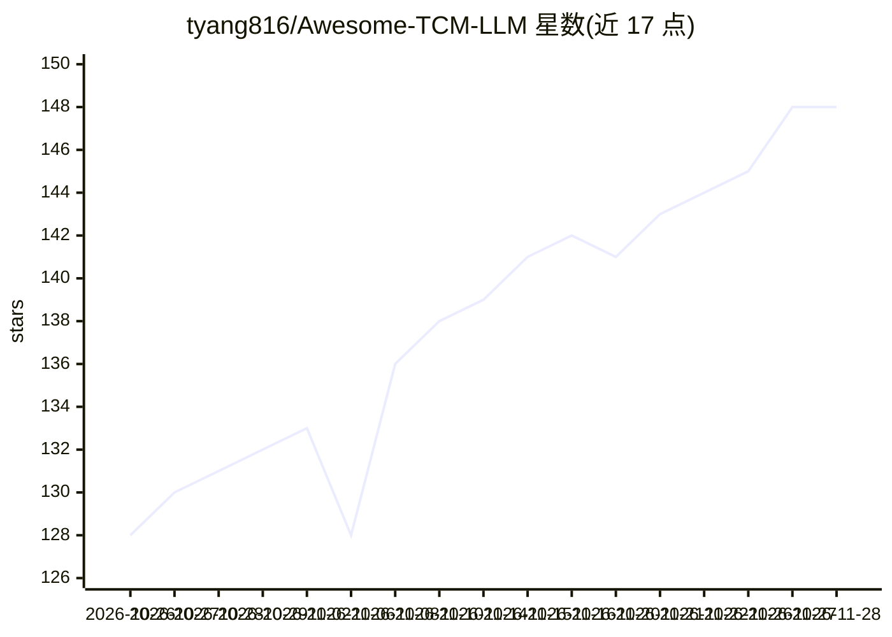

# tyang816/Awesome-TCM-LLM

⭐ 148 · Python · MIT · 推送 2026-11-24 · [GitHub](https://github.com/tyang816/Awesome-TCM-LLM) · 个人维护 · 中文 README

**中医大模型资源合集：模型/数据/论文/专利/导师导航**

面向中医药人工智能领域的中英双语资源清单，收录 117 个模型、206 个数据集、449 篇方法论文、95 篇综述、73 件专利、104 条新闻、36 门公开课及 452 位导师信息。README 按「能否下载复现权重」区分开源模型（21 个可下载）与仅有论文或产品的模型（50 个），另设通用中文医疗底座分区；导览表按问诊、舌诊、继续训练、对比实验等使用目的给出入口，并提示同名模型歧义问题。欢迎社区 PR 补充条目。

## 筛选速览

| 维度 | 判定 | 备注 |
|---|---|---|
| AI 角色 | `ai-knowledge` | 知识聚合/清单类 |
| 许可风险 | `permissive` | MIT |
| 部署形态 | `None` |  |
| 模型依赖 | — | README 未给出锁定关系 |
| 硬件要求 | — | 无带数字的原话,不猜 |
| 安装摩擦 | `low` | 无编译、无系统依赖或容器化 |
| 成熟度 | — | 结构信号不足 |

## 能力要点

- 收录 117 个中医大模型条目，其中 21 个标注可下载权重
- 按使用目的（本机跑通、问诊、舌诊、续训、对比实验）给出选型导览表
- 区分开源权重与仅论文/产品条目，并标注多模态、RAG、推理等特征
- 附 452 位中医药 AI 导师名单（按高校、产业、医院、地区分类）

## 适用场景

- 查找可下载权重的中医大模型做本机实验
- 为中医 LLM 研究寻找数据集、评测基准与综述
- 按任务（证候判别、处方、古籍今译）检索相关模型论文
- 了解中医药人工智能领域的导师与研究机构分布

## 场景标签

`精选清单` · 领域:学习与行业

## 证据(README 行号)

> L7: 开源中医模型、数据、论文、专利精选，也带一点相关中文医疗。现在大概有 104 条新闻、117 个模型、95 篇综述、73 件专利、206 个数据集、449 篇方法论文、36 门公开课，以及 452 位中医药人工智能导师。欢迎补条目。
> L88: ## 开源模型
> L13: 真能下载复现的中医权重大概 21 个，都在开源模型里。新闻里医院、公司发的，多数没有公开权重，当不了实验底座。

## 星数曲线

2026-10-26 128 → 2026-11-28 148（+20）

---
*卡片 v1 · prompt 1.4 · 生成 2026-11-27 · 置信度 high · 依据 README sha `5deca4b3aec5` · [字段定义](../../DATASET.md)*
