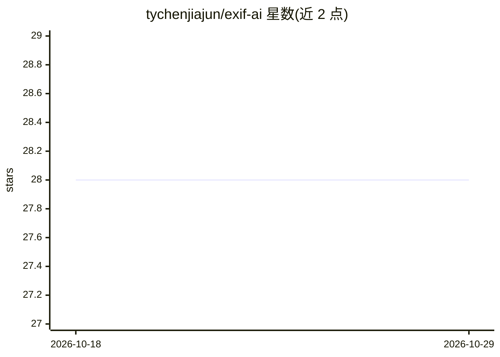

# tychenjiajun/exif-ai

⭐ 28 · TypeScript · GPL-2.0 · 推送 2026-10-28 · [GitHub](https://github.com/tychenjiajun/exif-ai) · 个人维护 · 中文 README

**为图片生成 AI 描述与标签并写入 EXIF 元数据的 CLI/库**

基于 Node.js 的命令行工具与 TypeScript 库，调用 13 家以上 AI 提供商（OpenAI、Gemini、Anthropic、Ollama、Bedrock 等）分析图像内容，生成描述和/或标签并写入图片 EXIF 元数据（如 XPComment、Keywords）。基于 Vercel AI SDK 构建统一接口，支持自定义提示词、目标 EXIF 标签、dry-run 预览、防覆盖等选项；提供从简单函数到流式构建器再到高级配置的四种库 API。Ollama 本地运行无需 API key，云端提供商需设置对应环境变量。

## 筛选速览

| 维度 | 判定 | 备注 |
|---|---|---|
| AI 角色 | `ai-native` | 本体是模型或模型工具 |
| 许可风险 | `viral` | GPL-2.0 |
| 部署形态 | `library` | 以包/库形式分发 |
| 模型依赖 | local-ok | 支持本地模型 |
| 硬件要求 | — | 无带数字的原话,不猜 |
| 安装摩擦 | `low` | 无编译、无系统依赖或容器化 |
| 成熟度 | — | 结构信号不足 |

## 能力要点

- 支持 13+ AI 提供商（含 Ollama 本地模型，无需 API key）
- AI 生成的描述与标签直接写入可配置的 EXIF 标签
- 提供 npx 免安装使用与 npm 全局安装
- 库形式提供简单 API、流式构建器、高级配置、旧版兼容四种接口

## 适用场景

- 为照片批量生成 AI 描述和关键词标签以便检索
- 用本地 Ollama 模型离线处理图片元数据保护隐私
- 在 TypeScript 项目中以库形式集成图像元数据自动标注

## 场景标签

`图像视频处理` · 领域:感知与多模态

## 证据(README 行号)

> L12: _Exif AI_ is a powerful CLI tool and library designed to write AI-generated image descriptions and/or tags directly
> L148: The `description` task generates a description of the image using the AI provider. The description is written to t

## 星数曲线

2026-10-18 28 → 2026-10-29 28（+0）

---
*卡片 v1 · prompt 1.4 · 生成 2026-10-26 · 置信度 high · 依据 README sha `c29628a67dc9` · [字段定义](../../DATASET.md)*
