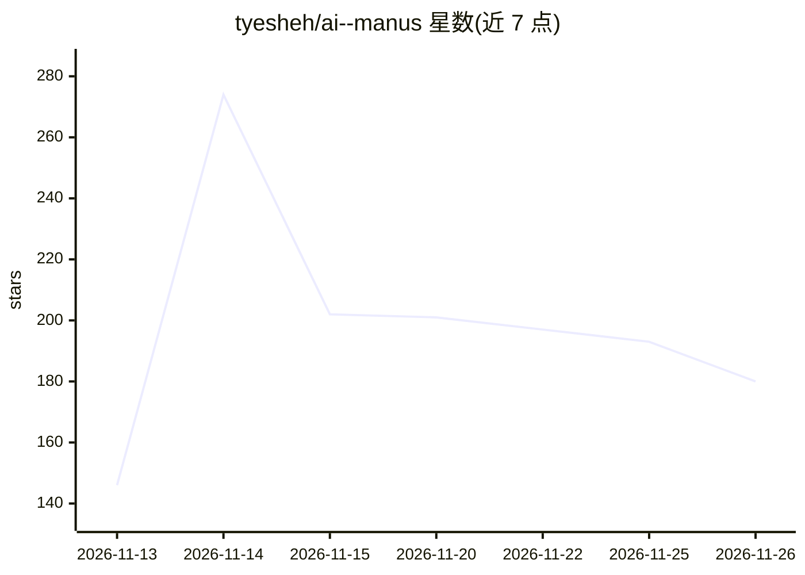

# tyesheh/ai--manus

⭐ 180 · Apache-2.0 · 推送 2026-11-14 · [GitHub](https://github.com/tyesheh/ai--manus) · 个人维护

**面向个人用户的自主 AI Agent：自动写代码并控制浏览器完成任务**

自称 Manus 的自主 AI Agent，README 描述其可自主编写并执行脚本、控制浏览器（打开网页、填写表单、抓取信息）、执行多步骤任务，供学习、家庭项目与轻量办公场景的非开发者使用；支持跨会话记忆工作流模式。README 为宣传式页面，给出兼容性表格（双核 CPU / 4GB RAM 起）与使用步骤说明，但未提供安装命令、仓库链接或代码结构说明，仅有『Download Manus / PROMO2026』字样，技术实现细节不可验证。

## 筛选速览

| 维度 | 判定 | 备注 |
|---|---|---|
| AI 角色 | `ai-native` | 本体是模型或模型工具 |
| 许可风险 | `permissive` | Apache-2.0 |
| 部署形态 | `None` |  |
| 模型依赖 | — | README 未给出锁定关系 |
| 硬件要求 | — | 无带数字的原话,不猜 |
| 安装摩擦 | `low` | 无编译、无系统依赖或容器化 |
| 成熟度 | — | 结构信号不足 |

## 能力要点

- 自主编写并执行代码完成任务的 Agent
- 浏览器控制：导航网页、填表、采集信息
- 面向家庭、学习、轻办公场景，声明无需开发者背景
- 跨会话记住工作流模式并重复应用

## 适用场景

- 让学生收集资料、跑小脚本、整理笔记
- 让 Agent 代为填写重复表单、抓取多页面信息
- 把日常小任务委托给后台个人助手处理

## 场景标签

`AI 助手` `浏览器自动化` `编码 Agent` · 领域:效率与自动化

## 证据(README 行号)

> L18: Manus is an autonomous AI agent designed to run code and control a browser on your behalf. Instead of acting like a
> L10: - **Autonomous Code Execution:** Manus AI agent runs code on its own to complete tasks, so you can focus on decisio

## 星数曲线

2026-11-13 146 → 2026-11-26 180（+34）

---
*卡片 v1 · prompt 1.4 · 生成 2026-11-17 · 置信度 mid · 依据 README sha `4347b4dd3fa7` · [字段定义](../../DATASET.md)*
