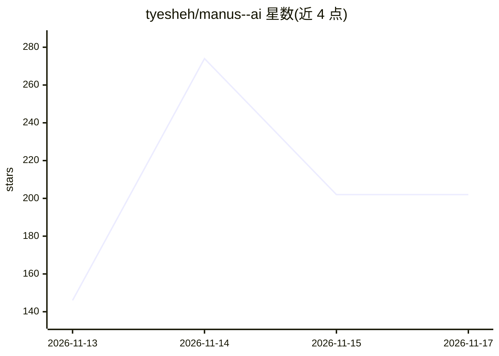

# tyesheh/manus--ai

⭐ 202 · Apache-2.0 · 推送 2026-11-14 · [GitHub](https://github.com/tyesheh/manus--ai) · 个人维护

**自主执行代码与控制浏览器的通用 AI Agent，面向日常小任务**

README 描述 Manus 为自主 AI agent，可代用户编写并执行脚本、控制浏览器（导航网页、填表、采集信息）并完成多步骤任务，定位为面向家庭、学习与轻量办公场景的个人助手，而非企业平台或重型套件。提到会话间保持工作模式一致性，任务可从脚本流转到浏览器。README 未提供代码仓库内容、安装命令或技术架构细节，仅给出硬件兼容表与使用步骤说明；仓库主题标签涉及 OpenAI、Anthropic、Gemini、React 等，但正文中未出现对应接入说明。

## 筛选速览

| 维度 | 判定 | 备注 |
|---|---|---|
| AI 角色 | `ai-native` | 本体是模型或模型工具 |
| 许可风险 | `permissive` | Apache-2.0 |
| 部署形态 | `None` |  |
| 模型依赖 | — | README 未给出锁定关系 |
| 硬件要求 | — | 无带数字的原话,不猜 |
| 安装摩擦 | `low` | 无编译、无系统依赖或容器化 |
| 成熟度 | — | 结构信号不足 |

## 能力要点

- 自主编写并执行代码完成任务
- 浏览器控制：导航、填表、采集信息
- 多步骤任务，脚本与浏览器操作可衔接
- 面向学习、家庭与轻量办公的小规模场景

## 适用场景

- 让 agent 代我跑小脚本和处理重复性代码工作
- 自动浏览网页、填表并汇总多个页面的信息
- 学习与日常项目中自动整理资料与文件

## 场景标签

`AI 助手` `浏览器自动化` · 领域:效率与自动化

## 证据(README 行号)

> L10: - **Autonomous Code Execution:** Manus AI agent runs code on its own to complete tasks, so you can focus on decisio
> L11: - **Browser Control Made Simple:** Manus browser control lets the agent navigate websites, fill forms, and gather i
> L18: Manus is an autonomous AI agent designed to run code and control a browser on your behalf. Instead of acting like a

## 星数曲线

2026-11-13 146 → 2026-11-17 202（+56）

---
*卡片 v1 · prompt 1.4 · 生成 2026-11-17 · 置信度 low · 依据 README sha `885ad01e4b6b` · [字段定义](../../DATASET.md)*
