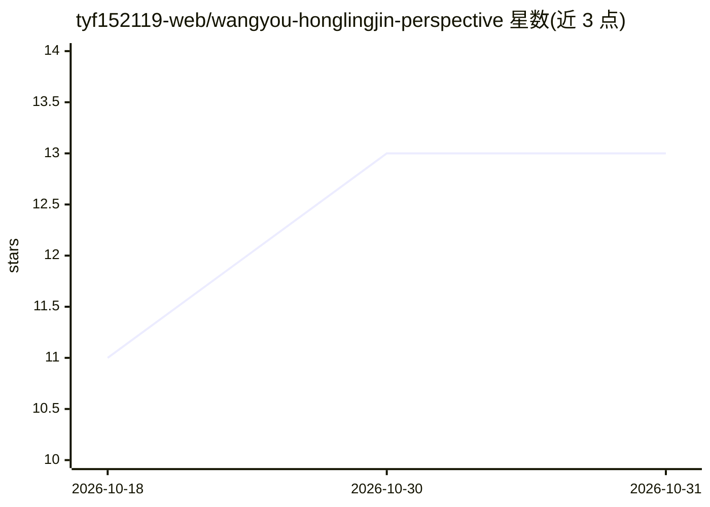

# tyf152119-web/wangyou-honglingjin-perspective

⭐ 13 · Python · MIT · 推送 2026-07-23 · [GitHub](https://github.com/tyf152119-web/wangyou-honglingjin-perspective) · 个人维护 · 中文 README

**公考做题、复盘与选岗决策的人物视角 Codex Skill**

面向 Codex agent 的人物视角 Skill：基于网友红领巾的 B 站公开视频、微博、清洗字幕与选择性 ASR，提炼 5 个心智模型、9 条决策启发式与表达规则。功能覆盖模考复盘、估算/精算深度决策、卡题路径预设、结合资格与地域的选岗分析，以及官方账号/假号/授权状态的事实核验。通过 Codex 对话指令或自带 Skill Installer 脚本安装，仓库不含原视频与字幕等原始材料，采用 MIT License。

## 筛选速览

| 维度 | 判定 | 备注 |
|---|---|---|
| AI 角色 | `ai-knowledge` | 知识聚合/清单类 |
| 许可风险 | `permissive` | MIT |
| 部署形态 | `None` |  |
| 模型依赖 | — | README 未给出锁定关系 |
| 硬件要求 | — | 无带数字的原话,不猜 |
| 安装摩擦 | `low` | 无编译、无系统依赖或容器化 |
| 成熟度 | — | 结构信号不足 |

## 能力要点

- 5 个心智模型与 9 条决策启发式提炼自 336 个视频/分 P 记录
- 身份与授权问题进入中性事实核验模式，不扮演本人
- 已通过 Nuwa 质量检查 6/6 与 Skill Creator 验证
- 仓库不含原视频、音频、字幕或 ASR 全文

## 适用场景

- 用该人物视角复盘模考的调度、读题与执行问题
- 对比候选岗位时获得资格、地域、家庭成本的取舍分析
- 核验'网友红领巾'相关账号是否本人或已授权

## 场景标签

 · 领域:公考备考/agent 技能

## 证据(README 行号)

> L3: 一个面向公考做题、备考复盘、选岗决策与账号来源核验的人物视角 Skill。
> L5: 基于网友红领巾的 B 站公开视频、官方微博、严格清洗字幕、原创专栏和选择性 ASR，提炼出 5 个心智模型、9 条决策启发式与可运行的表达规则。
> L59: - 336 个视频/分 P 记录，315 个唯一 BVID

## 星数曲线

2026-10-18 11 → 2026-10-31 13（+2）

---
*卡片 v1 · prompt 1.4 · 生成 2026-10-31 · 置信度 high · 依据 README sha `74f5da2d6de8` · [字段定义](../../DATASET.md)*
