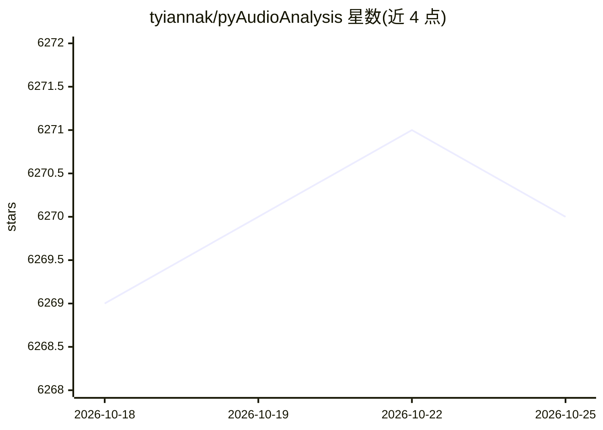

# tyiannak/pyAudioAnalysis

⭐ 6,270 · Python · Apache-2.0 · 推送 2026-10-09 · [GitHub](https://github.com/tyiannak/pyAudioAnalysis) · [官网](https://magcil.github.io) · 组织维护

**Python 音频分析库：特征提取、分类、分割**

面向开发者与科研用户的 Python 音频分析库，覆盖音频特征提取（MFCC、频谱、色度图）、音频段分类器训练与评估、未知声音分类、音频事件检测与静音排除、有监督/无监督分割（如说话人分离）、音频回归（如情绪识别）与降维可视化。提供 Python API 封装与命令行工具，安装通过 git clone、pip 依赖安装及 pip install -e . 完成。由希腊 NCSR Demokritos 研究所 MagCIL 组维护，附 2015 年发表的论文引用信息。

## 筛选速览

| 维度 | 判定 | 备注 |
|---|---|---|
| AI 角色 | `ai-native` | 本体是模型或模型工具 |
| 许可风险 | `permissive` | Apache-2.0 |
| 部署形态 | `library` | 以包/库形式分发 |
| 模型依赖 | — | README 未给出锁定关系 |
| 硬件要求 | — | 无带数字的原话,不猜 |
| 安装摩擦 | `low` | 无编译、无系统依赖或容器化 |
| 成熟度 | — | 结构信号不足 |

## 能力要点

- 提取 MFCC、频谱图、色度图等音频特征与表示
- 训练、调参、评估音频段分类器并分类未知声音
- 支持有监督/无监督分割（含说话人分离）与音频缩略图
- Python API 与命令行双通道，全部功能均有 CLI 支持

## 适用场景

- 训练音乐/语音等音频分类器并对未知音频分类
- 对长录音做事件检测与静音排除
- 做说话人分离或音频情绪识别实验

## 场景标签

`语音识别` · 领域:感知与多模态

## 证据(README 行号)

> L8: pyAudioAnalysis is a Python library covering a wide range of audio analysis tasks. Through pyAudioAnalysis you can:
> L10:  * *Train*, parameter tune and *evaluate* classifiers of audio segments
> L11:  * *Classify* unknown sounds

## 星数曲线

2026-10-18 6,269 → 2026-10-25 6,270（+1）

---
*卡片 v1 · prompt 1.4 · 生成 2026-10-20 · 置信度 high · 依据 README sha `7e2aee2118d6` · [字段定义](../../DATASET.md)*
