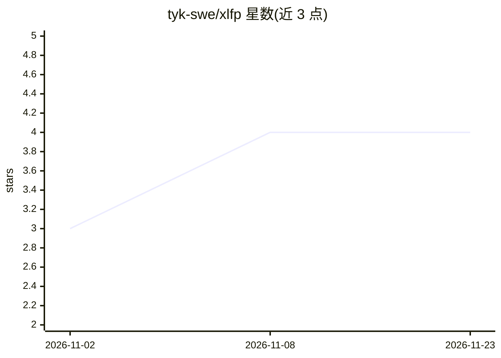

# tyk-swe/xlfp

⭐ 4 · Go · GPL-3.0 · 推送 2026-10-31 · [GitHub](https://github.com/tyk-swe/xlfp) · 个人维护

**通过 token 计数取证识别 LLM API 背后模型家族的 CLI 审计工具**

面向需要核验 LLM API 端点真实模型家族的开发者与研究人员：发送小型探测请求，比对端点报告的 token 计数与已知模型家族的 tokenizer 特征，输出 MATCH/MISMATCH/INCONCLUSIVE 判定及证据。支持 OpenAI-compatible、Anthropic、Gemini API 形状，可经 OpenCode 客户端做隐蔽测试；另附 Bayesian 开放集 tokenizer 检测与无 token 计数的行为信号检测器。具备请求上限控制、API key 环境变量隔离、JSON 输出等机制；README 明确列出无法区分同 tokenizer 家族等证据边界，不可信证据输出 INCONCLUSIVE。

## 筛选速览

| 维度 | 判定 | 备注 |
|---|---|---|
| AI 角色 | `ai-native` | 本体是模型或模型工具 |
| 许可风险 | `viral` | GPL-3.0 |
| 部署形态 | `library` | 以包/库形式分发 |
| 模型依赖 | locked-api |  |
| 硬件要求 | — | 无带数字的原话,不猜 |
| 安装摩擦 | `low` | 无编译、无系统依赖或容器化 |
| 成熟度 | — | 结构信号不足 |

## 能力要点

- uncover 识别家族与 audit 核验声明双模式
- 探测比对 token 计数，Bayesian 开放集 tokenizer 判定
- API key 经环境变量隔离发送，防跨端点泄露
- 提供 --json 输出与可安装的 agent skill

## 适用场景

- 核验陌生 LLM 端点背后最可能的模型家族
- 审计 API provider 对模型家族的声明是否与证据一致
- 在 agent 工作流中作为端点诊断步骤调用

## 场景标签

`模型评测` · 领域:评测与运维

## 证据(README 行号)

> L3: **Fingerprint the model family behind an LLM API — and check a provider's claim.**
> L11: - **Two ways to investigate:** `uncover` identifies a likely family;
> L13: - **Built for real endpoints:** OpenAI-compatible, Anthropic, and Gemini

## 星数曲线

2026-11-02 3 → 2026-11-23 4（+1）

---
*卡片 v1 · prompt 1.4 · 生成 2026-11-21 · 置信度 high · 依据 README sha `e6e64865fd49` · [字段定义](../../DATASET.md)*
