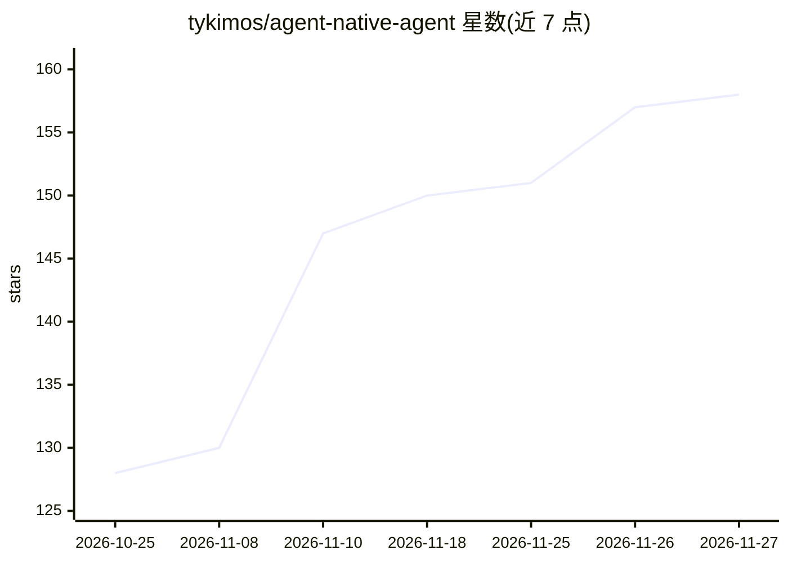

# tykimos/agent-native-agent

⭐ 158 · HTML · AGPL-3.0 · 推送 2026-11-26 · [GitHub](https://github.com/tykimos/agent-native-agent) · [官网](https://github.com/tykimos/ana-starter) · 个人维护 · 中文 README

**自托管应用：看仪表盘、对话式让编码代理实时构建与演进应用**

ANA 是一个自托管应用运行框架，核心机制是把编码代理（如 Claude Code）作为运行时：用户通过浏览器仪表盘观察状态并对话，代理读取数据、提出变更提案（before/after + 审批卡片），经批准后服务器应用 diff 并更新版本，应用在运行中被重写。界面含 PRD、Work、Knowledge、Requests、Evolve、Update 六个标签页。要求 Node ≥ 24、tmux 和编码代理 CLI，运行时本体零依赖；商业版（Pro）增加知识层、多工作区、角色管理等。

## 筛选速览

| 维度 | 判定 | 备注 |
|---|---|---|
| AI 角色 | `ai-ecosystem` | LLM/agent 周边工具 |
| 许可风险 | `viral` | AGPL-3.0 |
| 部署形态 | `library` | 以包/库形式分发 |
| 模型依赖 | — | README 未给出锁定关系 |
| 硬件要求 | — | 无带数字的原话,不猜 |
| 安装摩擦 | `low` | 无编译、无系统依赖或容器化 |
| 成熟度 | — | 结构信号不足 |

## 能力要点

- 代理即运行时：对话提出变更、审批后实时应用 diff 并重载仪表盘
- tmux capture-pane 循环通过 SSE 镜像会话，支持 Claude Code/Codex 结构化日志渲染
- 知识标签以本体与图组织条目，可让代理读取工作内容自动填充，文档上限 25 MB
- 提供 install skill 脚本：环境检查、按需安装依赖、tmux 启动与健康检查

## 适用场景

- 从对话和草图出发让代理写出 PRD 并搭建工作界面
- 在使用中直接用自然语言修改应用行为，无需 PR 和发布流程
- 自托管并完全拥有自己的工作应用

## 场景标签

`编码 Agent` · 领域:编码与开发

## 证据(README 行号)

> L22: **ANA is an _Agent‑Native Agent_ for _Agent‑Native Lifestyle_ (ANL).** It is a self‑hosted app you operate by **wat
> L57: There is **no bridge and no MCP**. The browser posts to the server, the server injects the text straight into the t
> L69: **Prerequisites:** Node ≥ 24, tmux, and a coding-agent CLI (e.g. Claude Code). The runtime (`channel-core.js`) has 

## 星数曲线

2026-10-25 128 → 2026-11-27 158（+30）

---
*卡片 v1 · prompt 1.4 · 生成 2026-11-27 · 置信度 high · 依据 README sha `4416a1984919` · [字段定义](../../DATASET.md)*
