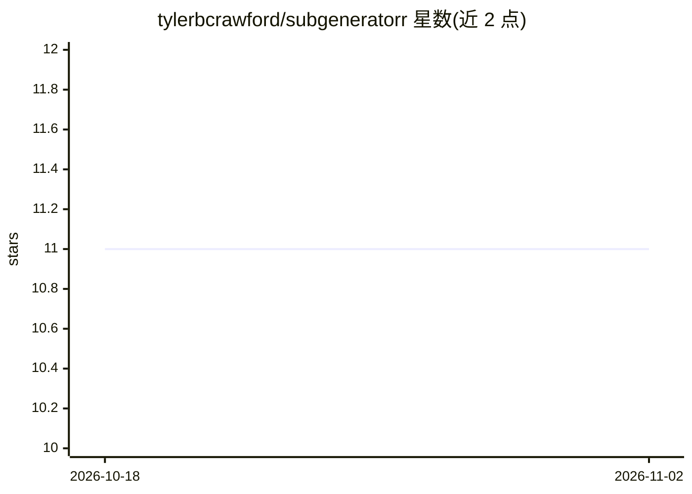

# tylerbcrawford/subgeneratorr

⭐ 11 · Python · MIT · 推送 2026-10-31 · [GitHub](https://github.com/tylerbcrawford/subgeneratorr) · [官网](https://github.com/tylerbcrawford/subgeneratorr/releases) · 个人维护

**为 Plex/Jellyfin/Emby 生成并翻译字幕的 Docker 工具**

以 Docker 容器（Web UI + CLI）形式运行的媒体字幕工具：扫描媒体库中缺失字幕的文件，用 Deepgram Nova-3 云端或本地 faster-whisper（CPU、离线、免费）转录，生成带语言标签的 SRT 边车文件供 Plex/Jellyfin/Emby 识别。转录后可用 Claude/GPT/Gemini 或本地 Ollama 模型进行关键词生成与翻译（98 种语言、保留时间轴），本地 Whisper 配合 Ollama 可实现全离线零成本流水线。云端引擎需 Deepgram API key；本地模式无需账号。

## 筛选速览

| 维度 | 判定 | 备注 |
|---|---|---|
| AI 角色 | `ai-native` | 本体是模型或模型工具 |
| 许可风险 | `permissive` | MIT |
| 部署形态 | `self-host` | docker 或自建部署 |
| 模型依赖 | local-ok | 支持本地模型 |
| 硬件要求 | `cpu-ok` | |
| 安装摩擦 | `low` | 无编译、无系统依赖或容器化 |
| 成熟度 | — | 结构信号不足 |

## 能力要点

- Deepgram Nova-3 与本地 faster-whisper（CPU 离线）逐任务切换
- keyterm prompting 提升专有名词识别（最高约 90% 提升）
- LLM 翻译至 98 种语言并保留时间轴，可选 Claude/GPT/Gemini/Ollama
- 全库缺失字幕扫描，按目录分组，支持 CSV 导出

## 适用场景

- 补齐没有社区字幕的冷门剧集和老旧剧集的字幕
- 把一次转录扩展成多语言字幕边车供媒体服务器识别
- 在自有硬件上完全离线、零成本地转录与翻译字幕

## 场景标签

`语音识别` · 领域:感知与多模态

## 证据(README 行号)

> L16: Subgeneratorr generates language-tagged SRT subtitles for the media Bazarr can't find — obscure shows, older episod
> L33: Every AI step after transcription is provider-agnostic too: keyterm generation and translation run on Claude, GPT, 

## 星数曲线

2026-10-18 11 → 2026-11-02 11（+0）

---
*卡片 v1 · prompt 1.4 · 生成 2026-11-01 · 置信度 high · 依据 README sha `8a3784ed4671` · [字段定义](../../DATASET.md)*
