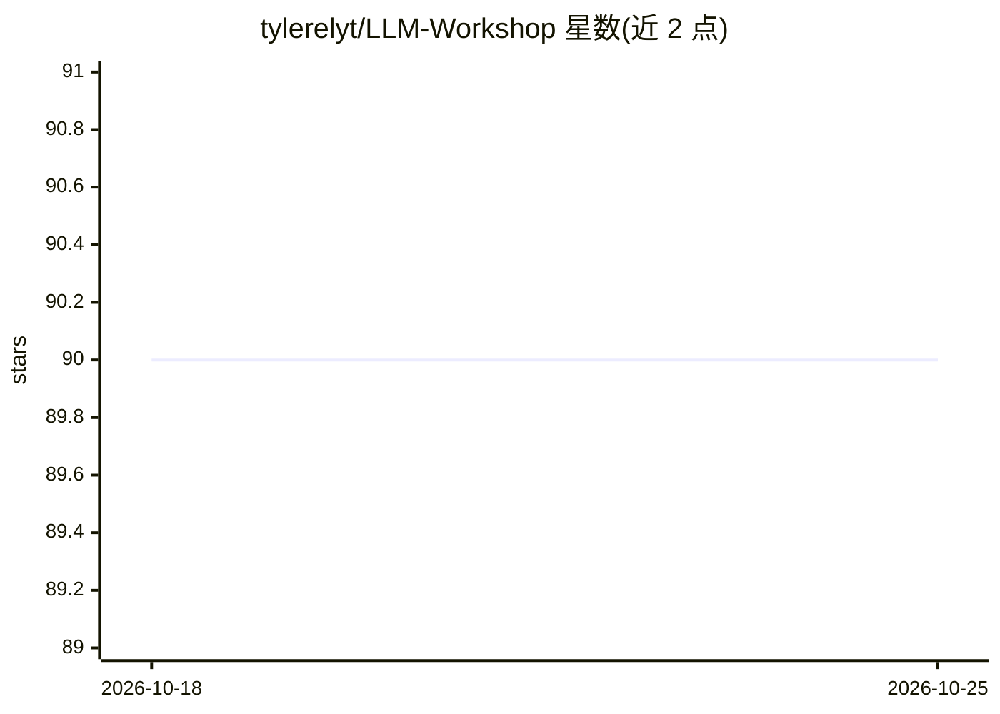

# tylerelyt/LLM-Workshop

⭐ 90 · Python · MIT · 推送 2025-11-20 · [GitHub](https://github.com/tylerelyt/LLM-Workshop) · 个人维护 · 中文 README

**面向开发者的 LLM 应用开发实战教程仓库（8 章）**

通过动手项目学习大模型应用开发的教学仓库：8 个章节覆盖对话系统、推理策略、RAG 与知识图谱、上下文工程、多模态（Qwen-VL-Max）、多 Agent 编排（AutoGen/ReAct/Reflexion）以及微调数据构建与微调基础，每章附带论文集合。以 git clone 源码方式获取，需 Python 3.8+ 与 OpenAI 或阿里 DashScope 的 API key（默认推荐 DashScope），在各 chapter 目录下运行脚本完成练习。

## 筛选速览

| 维度 | 判定 | 备注 |
|---|---|---|
| AI 角色 | `ai-knowledge` | 知识聚合/清单类 |
| 许可风险 | `permissive` | MIT |
| 部署形态 | `None` |  |
| 模型依赖 | — | README 未给出锁定关系 |
| 硬件要求 | — | 无带数字的原话,不猜 |
| 安装摩擦 | `low` | 无编译、无系统依赖或容器化 |
| 成熟度 | — | 结构信号不足 |

## 能力要点

- 8 章实战项目：从对话系统到多 Agent 编排与微调
- 每章附带相关论文集合（RAG、CoT、FlashAttention 等）
- 含 RAG（BGE-m3/BGE-reranker）、NL2SQL、知识图谱可视化等实现
- 需自备 OpenAI 或 DashScope API key

## 适用场景

- 从零动手构建 LLM 应用来学习开发
- 对照论文与生产级代码理解 RAG/Agent/微调技术
- 为转向 AI 工程的开发者提供系统化练习路径

## 场景标签

`教程课程` · 领域:学习与行业

## 证据(README 行号)

> L11: A practical workshop for building LLM applications from scratch. Learn by doing - each project guides you through e
> L26: ### 🧠 Chapter 1: Conversational Intelligence

## 星数曲线

2026-10-18 90 → 2026-10-25 90（+0）

---
*卡片 v1 · prompt 1.4 · 生成 2026-10-23 · 置信度 high · 依据 README sha `f21cb0b7b19e` · [字段定义](../../DATASET.md)*
