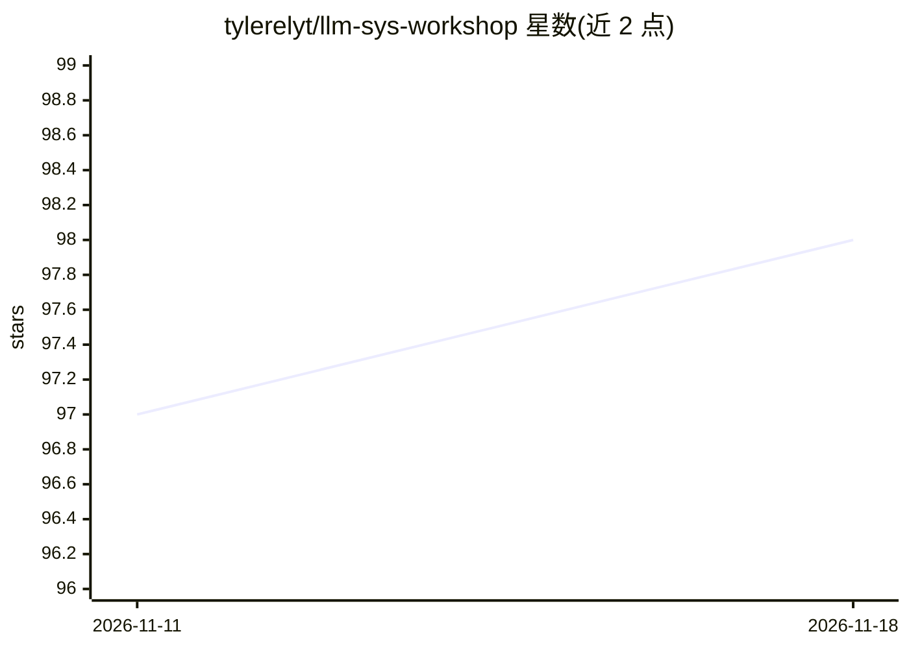

# tylerelyt/llm-sys-workshop

⭐ 98 · Python · MIT · 推送 2026-11-16 · [GitHub](https://github.com/tylerelyt/llm-sys-workshop) · 个人维护 · 中文 README

**动手学习大模型系统的中文教程与实践仓库**

以“Agent = Model + Harness”为主线的大模型系统学习仓库，按模型基础、数据与适配、知识与推理、Agent 与 Harness 四大主题组织数十个可运行实验，覆盖文档问答、检索与重排、NL2SQL、工具循环、记忆与恢复、MCP 接入、飞书技能封装、Self-Instruct 数据构造等。实验使用 Python 3.11/3.12 与兼容 OpenAI Chat Completions 的服务，从仓库根目录 clone 后建虚拟环境安装依赖运行；配套专栏与原始论文参考阅读，MIT 许可证。

## 筛选速览

| 维度 | 判定 | 备注 |
|---|---|---|
| AI 角色 | `ai-knowledge` | 知识聚合/清单类 |
| 许可风险 | `permissive` | MIT |
| 部署形态 | `library` | 以包/库形式分发 |
| 模型依赖 | — | README 未给出锁定关系 |
| 硬件要求 | — | 无带数字的原话,不猜 |
| 安装摩擦 | `low` | 无编译、无系统依赖或容器化 |
| 成熟度 | — | 结构信号不足 |

## 能力要点

- 按学习地图组织的四大主题实践索引，每个实验附代码入口
- MCP 工具发现、远程 MCP、Pi SDK 技能加载等接入实验
- 从标注数据到 Self-Instruct、偏好数据的后训练数据实验
- 配套专栏与论文参考阅读（Attention、Self-Instruct、RAG、ReAct 等）

## 适用场景

- 系统学习 LLM 原理并动手复现检索问答与 Agent 循环
- 为构建知识应用（文档问答、NL2SQL、知识图谱）找实践入口
- 理解 Harness 中上下文、工具权限、记忆与恢复的实现方式

## 场景标签

`教程课程` · 领域:学习与行业

## 证据(README 行号)

> L7: 模型负责理解、推理与生成，Harness 管理上下文、工具执行和任务状态。这里结合中文讲解、代码实验与参考阅读，学习模型原理、数据与适配、知识与推理，以及 Agent 的构建，理解 **Agent = Model + Harness
> L93: |实践|重点|代码|

## 星数曲线

2026-11-11 97 → 2026-11-18 98（+1）

---
*卡片 v1 · prompt 1.4 · 生成 2026-11-17 · 置信度 mid · 依据 README sha `7fa94d1bc115` · [字段定义](../../DATASET.md)*
