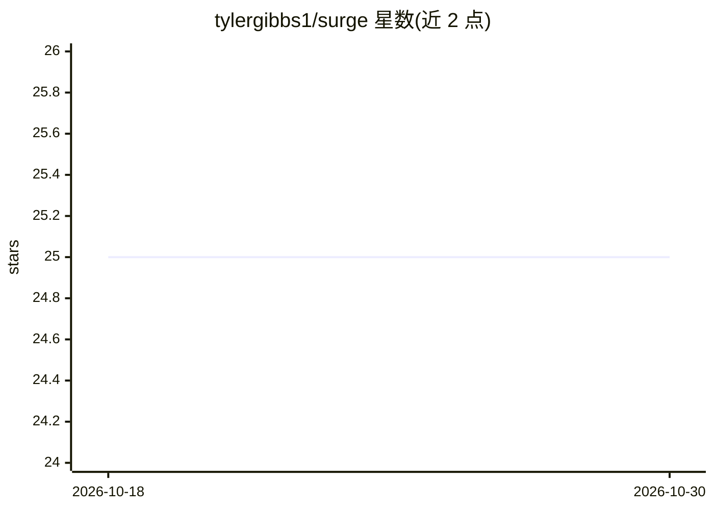

# tylergibbs1/surge

⭐ 25 · Python · MIT · 推送 2026-10-28 · [GitHub](https://github.com/tylergibbs1/surge) · [官网](https://surgeforecast.com) · 个人维护

**美国电网日前负荷概率预测：Chronos-2 微调模型+库+API+playground**

对 Chronos-2 基础模型在 7 年 EIA-930 数据（53 个报送需求的平衡机构）上微调，生成美国电网日前概率性负荷预测，输出中位数与 80% 区间。包含三部分：Python 库 surge（拉取并整合 EIA-930 负荷、ASOS 温度、风光出力等公开数据）、FastAPI 推理服务（NDJSON 流式、OpenAPI 文档）、Next.js 在线 playground（surgeforecast.com）。基准采用因果协变量策略，预测仅用预测时点可得信息；README 说明校准略有偏差（名义 80% 区间实际约 76%）且 5 个 BA 的 MASE 分母受异常值影响。

## 筛选速览

| 维度 | 判定 | 备注 |
|---|---|---|
| AI 角色 | `ai-native` | 本体是模型或模型工具 |
| 许可风险 | `permissive` | MIT |
| 部署形态 | `library` | 以包/库形式分发 |
| 模型依赖 | — | README 未给出锁定关系 |
| 硬件要求 | — | 无带数字的原话,不猜 |
| 安装摩擦 | `low` | 无编译、无系统依赖或容器化 |
| 成熟度 | — | 结构信号不足 |

## 能力要点

- Chronos-2 微调模型 surge-fm-v3，覆盖 53 个 EIA-930 平衡机构
- 因果协变量基准（causal_guard 扰动检验），2025 留出集 Test MASE 0.540
- Python 数据库 + FastAPI 推理服务 + 在线 playground 三件套
- 每日 06:15 UTC 定时全量预测并写入 Vercel Blob，边缘缓存回退 Modal 推理

## 适用场景

- 获取美国各平衡机构的日前负荷概率预测
- 拉取并整合 EIA-930 等公开电网数据做自己的分析
- 复现因果协变量协议下的负荷预测基准实验

## 场景标签

 · 领域:能源/电力负荷预测

## 证据(README 行号)

> L5: A fine-tuned Chronos-2 foundation model + FastAPI service + hosted
> L28: - `surge-fm-v3` — Chronos-2 fine-tuned on 7 years × 53 BAs of load with

## 星数曲线

2026-10-18 25 → 2026-10-30 25（+0）

---
*卡片 v1 · prompt 1.4 · 生成 2026-10-26 · 置信度 high · 依据 README sha `fd52e06ac8dd` · [字段定义](../../DATASET.md)*
