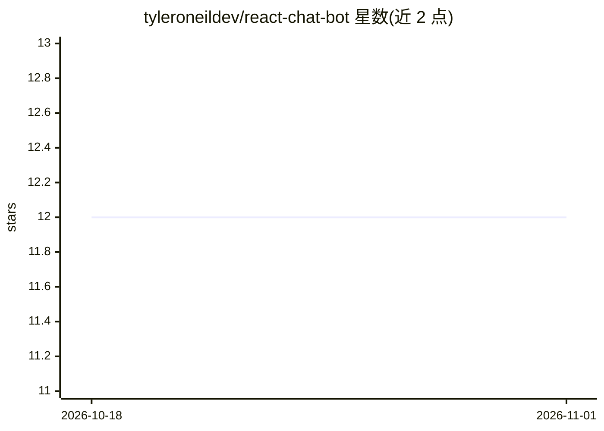

# tyleroneildev/react-chat-bot

⭐ 12 · JavaScript · MIT · 推送 2025-11-23 · [GitHub](https://github.com/tyleroneildev/react-chat-bot) · 个人维护

**基于 React/Node/Express 的可定制 OpenAI 聊天机器人**

Web 聊天机器人项目：前端 React.js，后端 Node.js/Express.js，通过 OpenAI API 的 ChatCompletion 接口生成对话回复，支持上下文感知的多轮问答，模型可通过 .env 配置（默认 gpt-4，注释称 GPT-4 效果最好）。用户需自行注册 OpenAI 账号并在 .env 中配置 API key。安装方式为 git clone 源码加 npm install，通过 npm start 运行。

## 筛选速览

| 维度 | 判定 | 备注 |
|---|---|---|
| AI 角色 | `ai-native` | 本体是模型或模型工具 |
| 许可风险 | `permissive` | MIT |
| 部署形态 | `library` | 以包/库形式分发 |
| 模型依赖 | — | README 未给出锁定关系 |
| 硬件要求 | — | 无带数字的原话,不猜 |
| 安装摩擦 | `low` | 无编译、无系统依赖或容器化 |
| 成熟度 | — | 结构信号不足 |

## 能力要点

- 调用 OpenAI ChatCompletion API 生成对话回复
- 基于会话上下文的问答能力
- 模型与 API key 通过 .env 配置，界面可定制

## 适用场景

- 部署一个网页聊天机器人与访客对话
- 作为二次开发的聊天机器人起点模板

## 场景标签

`聊天机器人` · 领域:对话与助手

## 证据(README 行号)

> L11: This is a chat bot built with React.js, Node.js and Express.js, integrated with OpenAI's API to provide natural lan
> L15: - Natural Language Processing (NLP) using OpenAI's API.

## 星数曲线

2026-10-18 12 → 2026-11-01 12（+0）

---
*卡片 v1 · prompt 1.4 · 生成 2026-10-31 · 置信度 high · 依据 README sha `b4acbdcd5b89` · [字段定义](../../DATASET.md)*
