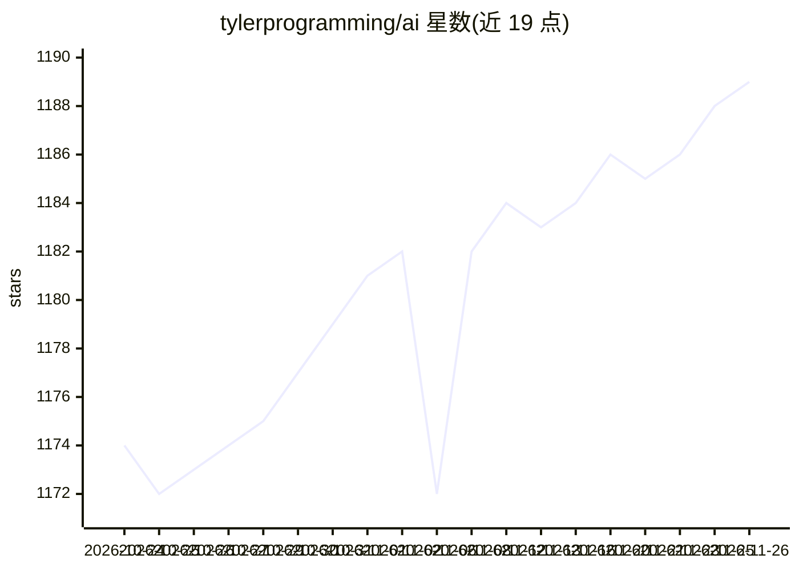

# tylerprogramming/ai

⭐ 1,189 · Python · MIT · 推送 2026-11-11 · [GitHub](https://github.com/tylerprogramming/ai) · 个人维护

**YouTube 频道配套的 AI Agent 框架教程与示例代码库**

面向其 YouTube 频道观众的 AI agent 学习仓库，汇集 AutoGen、CrewAI、PydanticAI、Smolagents、OpenAI Agents SDK/AgentOps 等框架的教程代码与简单示例。2026 年 10 月起所有项目按固定版本表更新并做离线冒烟测试（LLM 调用被模拟、外部服务打桩）。README 提供各框架 v0.7+/v1.15+/v2.x 的快速参考代码片段、环境要求（Python 3.11–3.13、Ollama 或 LM Studio）、两种示例运行方式，并附一个可脚手架 agent 项目的 Claude Code skill。

## 筛选速览

| 维度 | 判定 | 备注 |
|---|---|---|
| AI 角色 | `ai-knowledge` | 知识聚合/清单类 |
| 许可风险 | `permissive` | MIT |
| 部署形态 | `library` | 以包/库形式分发 |
| 模型依赖 | — | README 未给出锁定关系 |
| 硬件要求 | — | 无带数字的原话,不猜 |
| 安装摩擦 | `low` | 无编译、无系统依赖或容器化 |
| 成熟度 | — | 结构信号不足 |

## 能力要点

- 覆盖 7 个 agent 框架并给出统一版本矩阵与离线冒烟测试说明
- 提供 AutoGen v0.7 异步 API、CrewAI v1.15、PydanticAI v2.x 等快速参考片段
- 包含 Claude Code skill agent-builder 用于脚手架生成 agent 项目
- 多数示例为独立脚本，带 requirements.txt 或 CrewAI CLI 运行方式

## 适用场景

- 按视频教程运行对应的 agent 框架示例代码
- 查看 AutoGen v0.2 迁移到 v0.7 的 API 变化写法
- 用本地 Ollama/LM Studio 模型跑通示例

## 场景标签

`教程课程` · 领域:学习与行业

## 证据(README 行号)

> L7: A collection of AI agent projects, framework tutorials, and integrations. This is the main hub for code from my YouT
> L16: ├── frameworks/           # AI framework projects (simple examples, not full courses)
> L22: ## Framework Versions (October 2026)

## 星数曲线

2026-10-24 1,174 → 2026-11-26 1,189（+15）

---
*卡片 v1 · prompt 1.4 · 生成 2026-11-23 · 置信度 high · 依据 README sha `235b185fd24e` · [字段定义](../../DATASET.md)*
