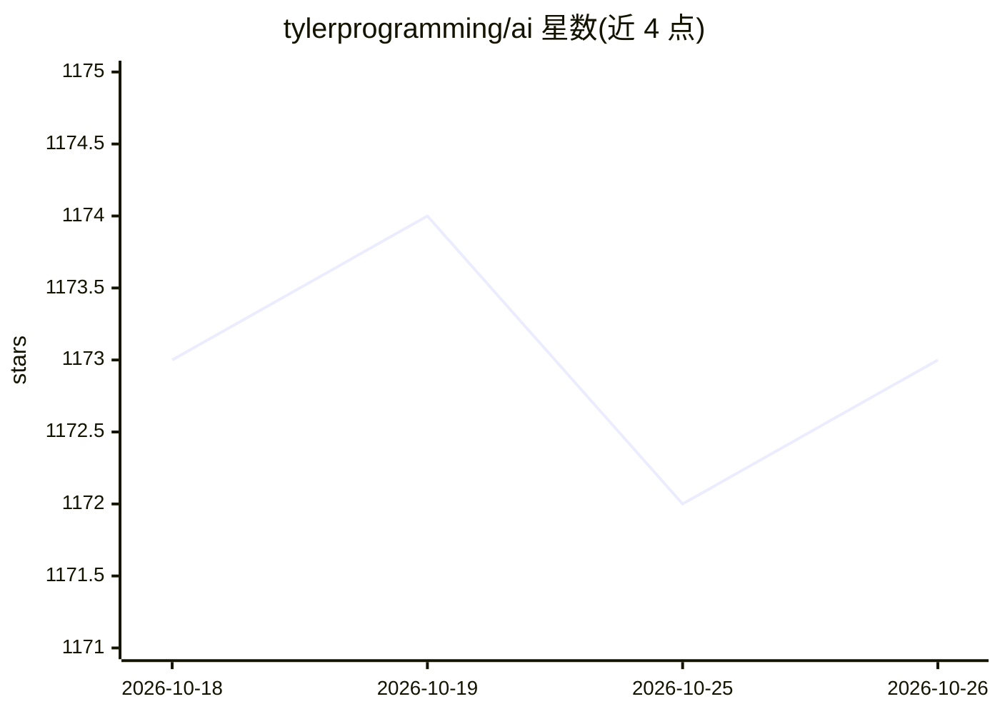

# tylerprogramming/ai

⭐ 1,173 · Python · MIT · 推送 2026-10-20 · [GitHub](https://github.com/tylerprogramming/ai) · 个人维护

**YouTube 博主的 AI agent 框架示例与教程代码合集**

个人教学向代码仓库，收录基于 AutoGen、CrewAI、PydanticAI、Smolagents、OpenAI Agents 等框架的 agent 示例项目与集成代码，作为其 YouTube 频道的配套源码。附各框架版本要点速查（AutoGen v0.7+ 新 API、CrewAI Flow 等）、Claude Code 技能 agent-builder、以及本地 LLM（Ollama / LM Studio）运行前提。示例多为独立工程，进入目录安装依赖后运行 main.py 即可。

## 筛选速览

| 维度 | 判定 | 备注 |
|---|---|---|
| AI 角色 | `ai-knowledge` | 知识聚合/清单类 |
| 许可风险 | `permissive` | MIT |
| 部署形态 | `library` | 以包/库形式分发 |
| 模型依赖 | — | README 未给出锁定关系 |
| 硬件要求 | — | 无带数字的原话,不猜 |
| 安装摩擦 | `low` | 无编译、无系统依赖或容器化 |
| 成熟度 | — | 结构信号不足 |

## 能力要点

- 覆盖 AutoGen/CrewAI/PydanticAI/Smolagents 等多框架示例
- AutoGen v0.7+ 新 API 速查与迁移说明
- 含 Claude Code 技能 agent-builder（脚手架生成 agent 项目）
- 示例支持 Ollama 与 LM Studio 本地 LLM

## 适用场景

- 学习各 AI agent 框架的入门示例
- 跟练 YouTube 教程并获取对应源码
- 参考 AutoGen v0.7+ 新 API 写法

## 场景标签

`Agent 框架` `教程课程` · 领域:Agent 开发

## 证据(README 行号)

> L7: A collection of AI agent projects, framework tutorials, and integrations. This is the main hub for code from my YouT
> L14: ├── frameworks/           # AI framework projects (simple examples, not full courses)
> L16: │   ├── autogen/         # AutoGen projects (includes v0.7+ examples)

## 星数曲线

2026-10-18 1,173 → 2026-10-26 1,173（+0）

---
*卡片 v1 · prompt 1.4 · 生成 2026-10-21 · 置信度 mid · 依据 README sha `68a3d610f64d` · [字段定义](../../DATASET.md)*
