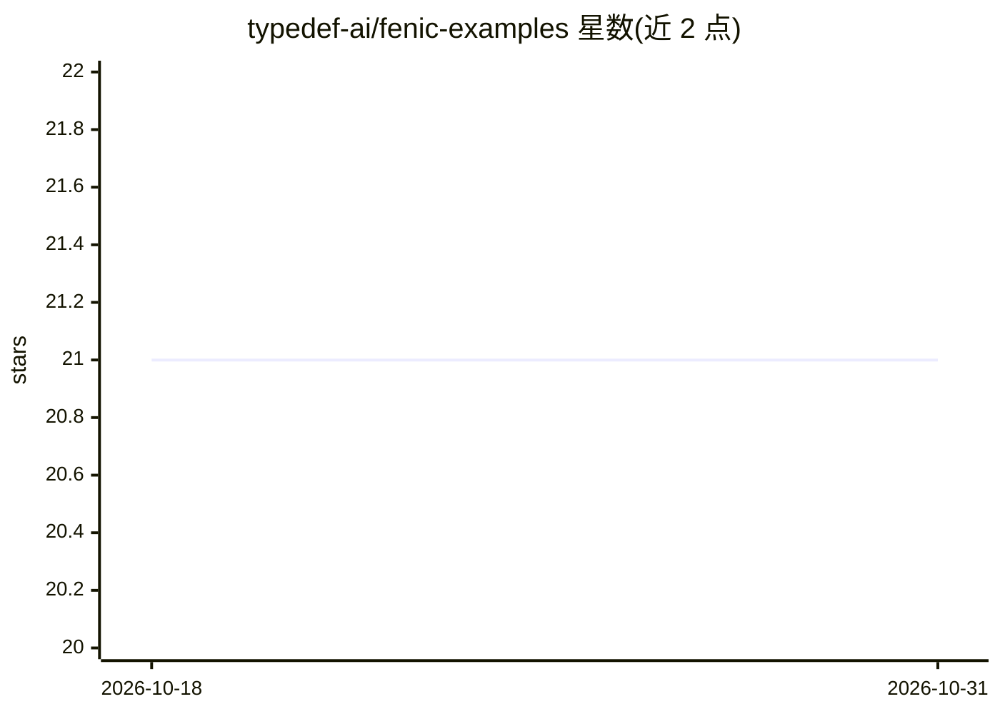

# typedef-ai/fenic-examples

⭐ 21 · Jupyter Notebook · 推送 2025-12-19 · [GitHub](https://github.com/typedef-ai/fenic-examples) · [官网](https://github.com/typedef-ai/fenic) · 组织维护

**Fenic 示例集合：演示语义 AI DataFrame 框架的示例工程**

收录多个示例工程，演示 Fenic（受 PySpark 启发、带语义 AI 能力的 Python DataFrame 框架）的用法：含 AI 特征工程管道（将文章转为嵌入、聚类与意图分类的语义特征表）、Hacker News 深度研究 agent、结合 LangGraph/LangChain 的值班日志分诊管道，以及把 PDF 转为可查询目录并提供 MCP 检索工具的 agent。多数示例提供 Colab 在线运行入口。面向使用或评估 Fenic 的数据工程与 agent 开发者。

## 筛选速览

| 维度 | 判定 | 备注 |
|---|---|---|
| AI 角色 | `ai-ecosystem` | LLM/agent 周边工具 |
| 许可风险 | `none` | — |
| 部署形态 | `None` |  |
| 模型依赖 | — | README 未给出锁定关系 |
| 硬件要求 | — | 无带数字的原话,不猜 |
| 安装摩擦 | `low` | 无编译、无系统依赖或容器化 |
| 成熟度 | — | 结构信号不足 |

## 能力要点

- AI 特征工程示例：文章转嵌入/聚类/意图分类特征表
- Hacker News 深度研究 agent 示例
- 日志分诊管道示例，搭配 LangGraph/LangChain 工具
- PDF 目录化 agent 示例，提供 MCP 文档检索工具

## 适用场景

- 学习如何用 Fenic 构建语义 AI 数据管道
- 参考 agent 与 DataFrame 框架结合的实现方式
- 在 Colab 中直接运行示例快速上手

## 场景标签

`Agent 框架` `RAG` `教程课程` · 领域:Agent 开发

## 证据(README 行号)

> L3: A collection of example projects demonstrating the capabilities of fenic, a PySpark-inspired DataFrame framework wit
> L9: |ai_feature_engineering|AI-powered feature engineering pipeline that transforms articles into semantic feature table

## 星数曲线

2026-10-18 21 → 2026-10-31 21（+0）

---
*卡片 v1 · prompt 1.4 · 生成 2026-10-28 · 置信度 mid · 依据 README sha `6ded954332b3` · [字段定义](../../DATASET.md)*
