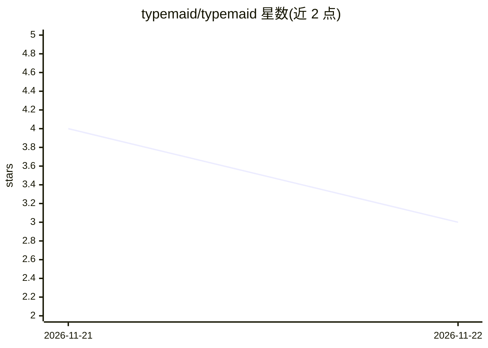

# typemaid/typemaid

⭐ 3 · TypeScript · NOASSERTION · 推送 2026-11-19 · [GitHub](https://github.com/typemaid/typemaid) · [官网](https://www.npmjs.com/package/typemaid) · 个人维护

**TypeScript SDK：把 Mermaid 流程图作为类型化 AI 工作流运行**

TypeMaid 是一个 TypeScript SDK，开发者用 Mermaid `.mmd` 文件描述流程（分支、循环、并行、for-each），每个节点对应一个用 Zod 声明输入输出的 TypeScript 导出；控制流编译为 JSON，由引擎按图执行。Agent 步骤与工具内的模型调用通过 Vercel AI SDK 接入任意受支持的 provider。运行可暂停等待人工决定，状态可持久化到 SQLite/Postgres/libSQL 并在后续进程恢复。提供 `check` 静态检查与只读可视化查看器（独立可选包）。v0 阶段，API 可能变动。

## 筛选速览

| 维度 | 判定 | 备注 |
|---|---|---|
| AI 角色 | `ai-ecosystem` | LLM/agent 周边工具 |
| 许可风险 | `none` | NOASSERTION |
| 部署形态 | `library` | 以包/库形式分发 |
| 模型依赖 | — | README 未给出锁定关系 |
| 硬件要求 | — | 无带数字的原话,不猜 |
| 安装摩擦 | `low` | 无编译、无系统依赖或容器化 |
| 成熟度 | `idea` | |

## 能力要点

- Mermaid 图即程序：控制流编译为 JSON，不由模型决定下一步
- Zod 类型化步骤，运行前报告图/工具问题并给出修复建议
- 暂停-恢复的持久化执行，支持 SQLite、Postgres、libSQL 存储
- 通过 Vercel AI SDK 支持 OpenAI、Anthropic、Gemini、Ollama、LiteLLM 等

## 适用场景

- 把画好的 Mermaid 流程图直接变成可执行的 AI 工作流
- 构建需要人工审批节点的工作流（暂停后恢复）
- 用 AI judge 循环打分迭代生成内容直至达标

## 场景标签

`工作流自动化` · 领域:效率与自动化

## 证据(README 行号)

> L6:  A TypeScript SDK: draw the flow, type each step, and run it with any LLM.
> L62: - **The diagram is the program.** Branches, loops, parallel steps and for-each blocks are written in Mermaid. The c
> L65: - **Any LLM.** Agent steps and model calls inside tools use the Vercel AI SDK, so any provider it supports works: O

## 星数曲线

2026-11-21 4 → 2026-11-22 3（-1）

---
*卡片 v1 · prompt 1.4 · 生成 2026-11-21 · 置信度 high · 依据 README sha `700c898b2298` · [字段定义](../../DATASET.md)*
