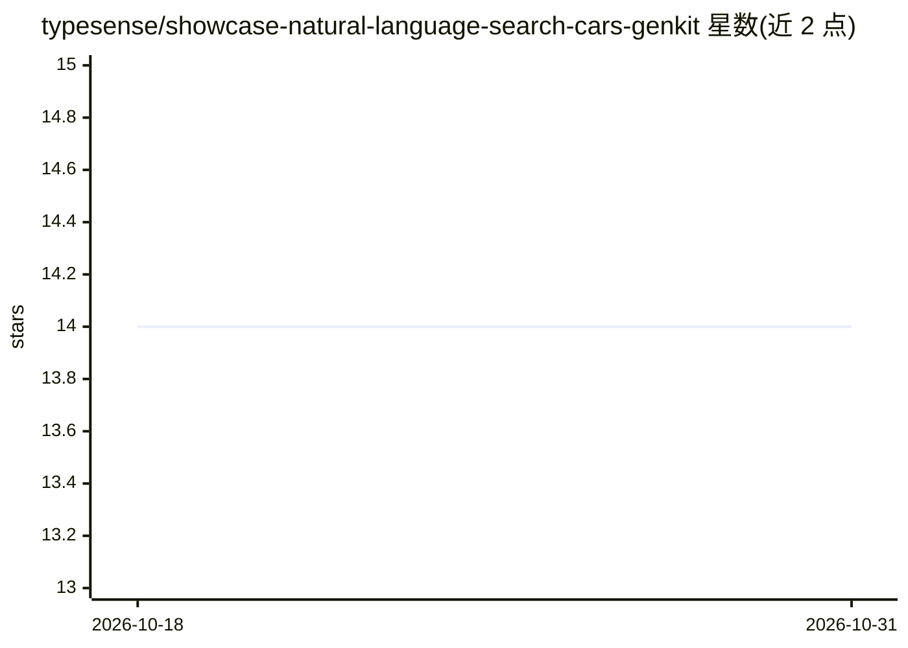

# typesense/showcase-natural-language-search-cars-genkit

⭐ 14 · TypeScript · 推送 2026-05-04 · [GitHub](https://github.com/typesense/showcase-natural-language-search-cars-genkit) · [官网](https://natural-language-search-cars-genkit.typesense.org) · 组织维护

**用 Genkit+Gemini 将自然语言转为 Typesense 查询的汽车搜索示例应用**

Typesense 官方 showcase 项目：基于 NextJS 的示例 Web 应用，演示"Generation Augmented Retrieval"——由 Google Gemini（经 Firebase Genkit）将用户的自然语言描述转换为 Typesense 查询，在含 6500 条汽车记录的 Kaggle 数据集上检索。技术栈为 TypeScript/React Query/Tailwind。运行需 Docker 与 Node.js，流程包括启动 Typesense 服务、索引数据、更新集合元数据（为 LLM 提供字段信息）后启动开发服务器。属演示/教学性质，非通用产品。

## 筛选速览

| 维度 | 判定 | 备注 |
|---|---|---|
| AI 角色 | `ai-native` | 本体是模型或模型工具 |
| 许可风险 | `none` | — |
| 部署形态 | `self-host` | docker 或自建部署 |
| 模型依赖 | — | README 未给出锁定关系 |
| 硬件要求 | — | 无带数字的原话,不猜 |
| 安装摩擦 | `low` | 无编译、无系统依赖或容器化 |
| 成熟度 | — | 结构信号不足 |

## 能力要点

- Gemini 将自然语言转换为 Typesense 查询（GAR 技术）
- 6500 条汽车数据集（Kaggle）
- 集合元数据为 LLM 提供字段信息

## 适用场景

- 参考如何为 Typesense 搜索接入 LLM 做自然语言查询
- 学习 Genkit 与 Typesense 的集成方式
- 作为自然语言搜索应用的起步模板

## 场景标签

`语义搜索` `教程课程` · 领域:知识与检索

## 证据(README 行号)

> L3: Search for the perfect car by describing it in natural language. We use a technique called "Generation Augmented Ret
> L9: - Google Gemini

## 星数曲线

2026-10-18 14 → 2026-10-31 14（+0）

---
*卡片 v1 · prompt 1.4 · 生成 2026-10-31 · 置信度 high · 依据 README sha `4d1043f188e6` · [字段定义](../../DATASET.md)*
