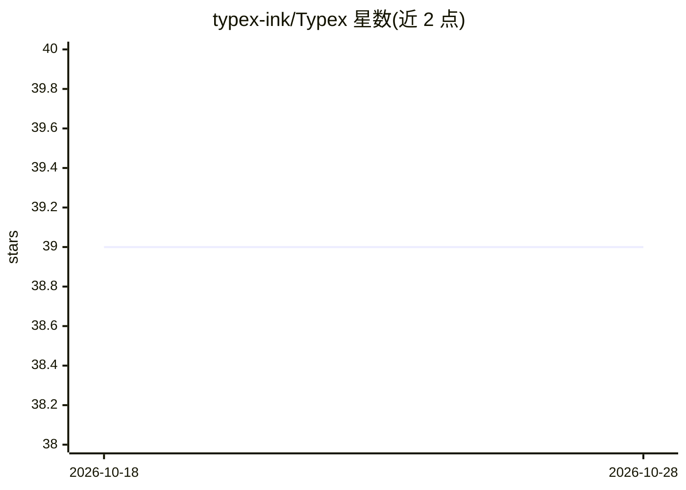

# typex-ink/Typex

⭐ 40 · Rust · GPL-3.0 · 推送 2026-09-13 · [GitHub](https://github.com/typex-ink/Typex) · [官网](typex.ink) · 个人维护 · 中文 README

**开源桌面 AI 语音输入工具：说话即转文字到任意应用**

基于 Tauri 2 与 Rust 构建的桌面语音输入工具：按住全局快捷键说话，Typex 将清理后的文本（去填充词、修标点）直接注入当前光标位置。支持语音翻译、选中文本后用语音指令改写/翻译/总结的上下文助手。BYOK 模式，可接入 OpenAI 兼容 API、火山引擎/豆包 STT、Ollama 或自托管端点，也支持下载 SenseVoice、Qwen3-ASR、Whisper large-v3、Qwen GGUF 等本地模型离线使用。GPL-3.0 许可，无遥测。Windows/macOS 提供安装包。

## 筛选速览

| 维度 | 判定 | 备注 |
|---|---|---|
| AI 角色 | `ai-native` | 本体是模型或模型工具 |
| 许可风险 | `viral` | GPL-3.0 |
| 部署形态 | `desktop` | 安装包/桌面程序 |
| 模型依赖 | local-ok | 支持本地模型 |
| 硬件要求 | — | 无带数字的原话,不猜 |
| 安装摩擦 | `low` | 无编译、无系统依赖或容器化 |
| 成熟度 | — | 结构信号不足 |

## 能力要点

- 按住全局快捷键说话，文本清理后注入任意应用光标处
- BYOK：支持 OpenAI 兼容 API、Ollama、自托管端点等
- 本地离线模型：SenseVoice、Qwen3-ASR、Whisper large-v3、Qwen GGUF
- 选中文本后语音指令改写/翻译/总结，答案以只读弹窗展示

## 适用场景

- 在任意应用中用语音输入整理好的文字
- 说一种语言输出另一种语言的文字
- 完全本地离线完成语音转文字与指令处理

## 场景标签

`语音识别` `AI 写作` · 领域:内容生成

## 证据(README 行号)

> L11: Typex is an open-source, desktop AI voice input tool. Hold a shortcut and speak — Typex types the cleaned-up text d
> L15: - **Native-grade performance**: Built on Tauri 2 and Rust. Recording, global shortcuts, provider calls, local infer

## 星数曲线

2026-10-18 39 → 2026-10-28 39（+0）

---
*卡片 v1 · prompt 1.4 · 生成 2026-10-25 · 置信度 high · 依据 README sha `15a9766f23c4` · [字段定义](../../DATASET.md)*
