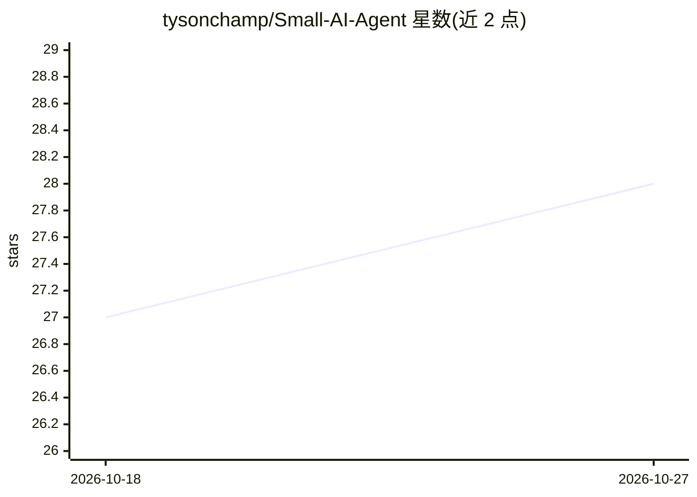

# tysonchamp/Small-AI-Agent

⭐ 28 · Python · MIT · 推送 2026-03-13 · [GitHub](https://github.com/tysonchamp/Small-AI-Agent) · 个人维护

**自托管个人 AI 助手：Telegram 机器人 + Web 面板，本地 Ollama 驱动**

面向个人用户的自托管 AI 助手平台，通过 Telegram 机器人和 Web Dashboard 交互。功能包括网站监控（AI 生成变更摘要）、ERP 集成（任务/发票/凭据的自然语言管理）、本地与 SSH 远程服务器健康检查、DuckDuckGo 网络搜索、IMAP 邮件摘要、提醒、笔记、工作流、Shell 命令执行等。基于 LangChain 构建，由 Ollama 提供本地模型推理（Gemma/Qwen/Mistral 等），ChromaDB 存储对话记忆；采用提示词路由工具调用，不要求模型原生 tool calling。安装需 Python 3.10+、Ollama 运行环境和 Telegram Bot Token，提供 systemd 服务运行方式。

## 筛选速览

| 维度 | 判定 | 备注 |
|---|---|---|
| AI 角色 | `ai-native` | 本体是模型或模型工具 |
| 许可风险 | `permissive` | MIT |
| 部署形态 | `None` |  |
| 模型依赖 | local-ok | 支持本地模型 |
| 硬件要求 | — | 无带数字的原话,不猜 |
| 安装摩擦 | `low` | 无编译、无系统依赖或容器化 |
| 成熟度 | — | 结构信号不足 |

## 能力要点

- 提示词式工具路由，兼容任意 LLM（无需原生 tool calling）
- Ollama 本地推理 + ChromaDB 持久记忆，数据不出本地
- 13 类工具：网站监控、ERP、SSH 服务器监控、邮件、SEO 分析、运行时动态生成工具等
- Web Dashboard 提供服务器健康、网站状态、日志流、SQLite 浏览与网页聊天

## 适用场景

- 通过 Telegram 对话管理任务、发票与凭据（ERP 集成）
- 监控网站变更并由 AI 生成变更摘要
- 用自然语言执行提醒、笔记、每日简报等个人事务
- 监控本地与远程 SSH 服务器健康状态

## 场景标签

`AI 助手` `聊天机器人` · 领域:对话与助手

## 证据(README 行号)

> L3: A powerful, self-hosted AI assistant that combines **website monitoring**, **ERP integration**, **system health chec
> L10: - **Local Privacy** — Runs 100% locally using Ollama (Gemma, Qwen, Mistral, etc.).
> L27: |👁️ **Web Monitor**|Tracks changes on websites and sends AI-powered change summaries|

## 星数曲线

2026-10-18 27 → 2026-10-27 28（+1）

---
*卡片 v1 · prompt 1.4 · 生成 2026-10-26 · 置信度 high · 依据 README sha `f37e9665a98a` · [字段定义](../../DATASET.md)*
