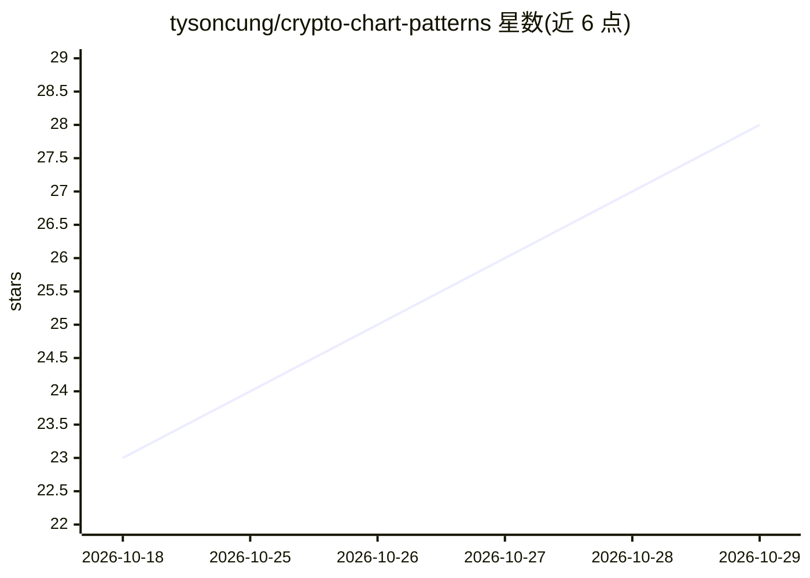

# tysoncung/crypto-chart-patterns

⭐ 28 · Jupyter Notebook · MIT · 推送 2026-05-05 · [GitHub](https://github.com/tysoncung/crypto-chart-patterns) · 个人维护

**加密货币 K 线图形态自动检测工具（15 类形态）**

Python 编写的技术分析工具：从 Binance API 拉取实时行情数据，通过局部极值检测结合数学分析自动识别头肩顶/底、双顶/底、三角形、楔形、旗形、通道、杯柄等 15 类图形态，并在价格图上可视化标注。提供命令行与 Python API 两种用法，支持 1m 至 1d 共 7 个时间周期，含 90%+ 覆盖率的测试套件与 GitHub Actions CI/CD，并做形态后收益分析用于验证。README 声明仅用于教育与研究目的。

## 筛选速览

| 维度 | 判定 | 备注 |
|---|---|---|
| AI 角色 | `ai-native` | 本体是模型或模型工具 |
| 许可风险 | `permissive` | MIT |
| 部署形态 | `library` | 以包/库形式分发 |
| 模型依赖 | — | README 未给出锁定关系 |
| 硬件要求 | — | 无带数字的原话,不猜 |
| 安装摩擦 | `low` | 无编译、无系统依赖或容器化 |
| 成熟度 | — | 结构信号不足 |

## 能力要点

- 基于局部极值检测与数学分析的 15 类图形态自动识别
- 实时拉取 Binance 数据，支持 1m–1d 七个时间周期
- 形态在价格图上可视化标注，并附前向收益分析
- 提供命令行与 Python API，测试覆盖率 90%+，GitHub Actions CI/CD

## 适用场景

- 我想自动扫描 ETH 等加密货币的 K 线图形态
- 对识别出的形态做前向收益验证
- 在 Python 研究流程中调用形态检测 API

## 场景标签

`金融量化` · 领域:学习与行业

## 证据(README 行号)

> L9: This project implements comprehensive pattern recognition algorithms to identify chart patterns in cryptocurrency pr
> L28: - Automatic pattern detection using mathematical algorithms

## 星数曲线

2026-10-18 23 → 2026-10-29 28（+5）

---
*卡片 v1 · prompt 1.4 · 生成 2026-10-26 · 置信度 low · 依据 README sha `9cc954160939` · [字段定义](../../DATASET.md)*
