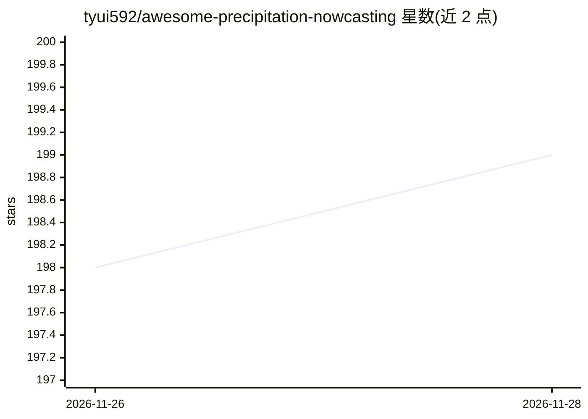

# tyui592/awesome-precipitation-nowcasting

⭐ 199 · 推送 2026-11-25 · [GitHub](https://github.com/tyui592/awesome-precipitation-nowcasting) · 个人维护

**降水临近预报论文与资源策展清单**

一份收录降水临近预报（precipitation nowcasting）领域论文、代码、竞赛与数据集的策展清单。按方法组织条目，覆盖 ConvLSTM、TrajGRU、U-Net、扩散模型、flow matching 等路线，每条提供论文链接，多数附 GitHub 代码仓库，部分附博客、权重或推理示例链接。另设 Workshop 板块收录 NeurIPS 相关研讨会与 Weather4cast 竞赛页面，以及 Library、Dataset、Others 板块。通过邮件或 pull request 接受补充与更新。

## 筛选速览

| 维度 | 判定 | 备注 |
|---|---|---|
| AI 角色 | `ai-knowledge` | 知识聚合/清单类 |
| 许可风险 | `none` | — |
| 部署形态 | `None` |  |
| 模型依赖 | — | README 未给出锁定关系 |
| 硬件要求 | — | 无带数字的原话,不猜 |
| 安装摩擦 | `low` | 无编译、无系统依赖或容器化 |
| 成熟度 | — | 结构信号不足 |

## 能力要点

- 按方法路线组织论文与代码条目（ConvLSTM/TrajGRU/扩散模型/flow matching 等）
- 多数条目附 GitHub 代码仓库链接
- 部分条目提供预训练权重与推理示例链接
- 收录 NeurIPS 相关研讨会与 Weather4cast 竞赛资源

## 适用场景

- 查找降水临近预报方向的论文与开源代码
- 调研该领域从 RNN 到生成模型的方法演进
- 寻找相关竞赛（Weather4cast）与研讨会资料

## 场景标签

`精选清单` · 领域:学习与行业

## 证据(README 行号)

> L4: A curated list of papers, code, competitions, and datasets for precipitation nowcasting.
> L15: :paperclip: Papers&Codes

## 星数曲线

2026-11-26 198 → 2026-11-28 199（+1）

---
*卡片 v1 · prompt 1.4 · 生成 2026-11-26 · 置信度 high · 依据 README sha `1ecbe40c8562` · [字段定义](../../DATASET.md)*
